# YuTreno

*You drive the train, or your algorithm does.*

YuTreno is a train driving simulator that runs in the browser, designed for research and teaching. A train can be driven by hand from the cab or handed over to an automatic controller, written in JavaScript or in any language that speaks WebSocket (there is an example in Python). The same line can be run with ERTMS/ETCS level 2 or with the automatic block and SCMT protection, to compare the two systems. Lines and trains are drawn and edited from the interface.

Around the driven train the line can have a whole traffic: service trains with a timetable in both directions, networks of lines that meet in shared stations, real lines imported from OpenStreetMap and RINF, passengers on the platforms and on board, a traffic regulator and a control room. A run publishes its timetable and its progress as open data (GTFS, GTFS-Realtime, SIRI, NeTEx, railML).

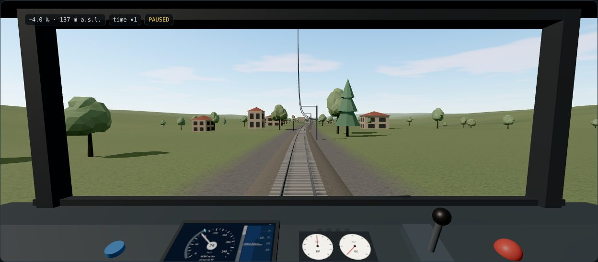

The view is from the cab, in 3D. Through the windscreen you see the line with its curves, gradients and tunnels, the stations, the catenary, the signals and the train ahead. On the desk there are the DMI, the gauges, the lever and the vigilance and emergency buttons. Light and atmosphere change with the time of day and the weather. A lighter 2D view remains available, also for browsers without WebGL.

| | |
| :-: | :-: |
| 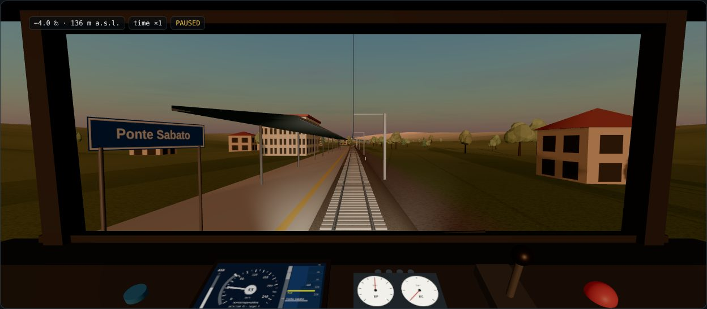 | 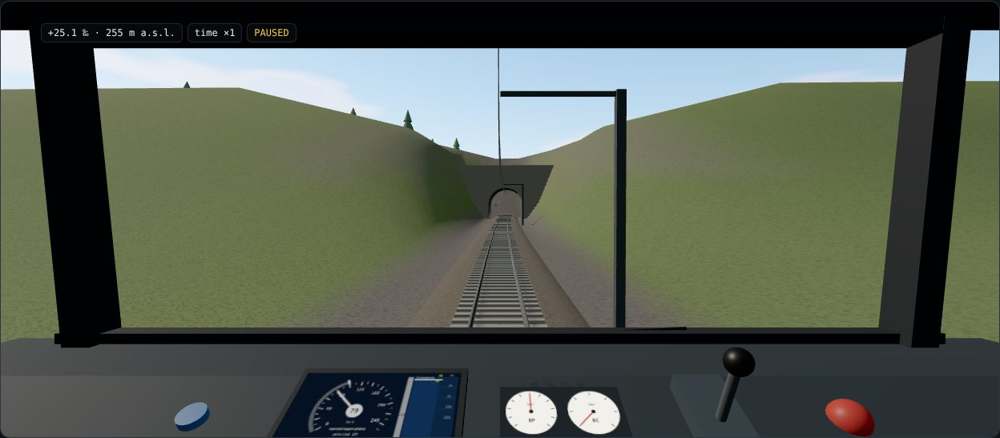 |
| 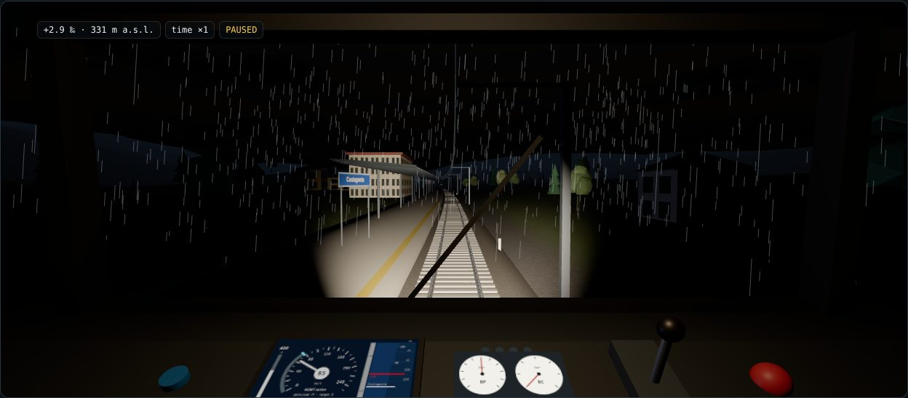 | 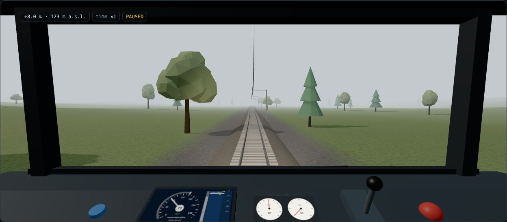 |

The train is simulated as a chain of vehicles connected by couplers with slack, stiffness and damping (multi-mass model), or as a point mass for teaching. The page `dist/model.html`, generated by the build, describes the model with equations, checks and an interactive laboratory. The simulation advances with a fixed step of 5 ms and is deterministic: with the same line, train, scenario and commands, two runs produce the same data. Without graphics a complete run takes one or two seconds.

## Quick start

```bash
npm install
npm run dev          # interface on http://localhost:8000
npm run build        # dist/yutreno.html, a single file that opens with a double click
npm run verify       # all the checks: physics, signalling, onboard, trackside, traffic, network, passengers, open data, requirements
npm run headless -- --line appennino --signalling BACC --output runs
npm run headless -- --scenario scenarios                  # all event and fault scenarios, with verdict
npm run headless -- --onboard reference                   # ETCS with balises, RBC messages and the reference onboard
npm run headless -- --onboard reference --trackside interlocking   # plus interlocking and RBC with routes, points and track circuits
npm run headless -- --dynamics tcp://localhost:5555       # train dynamics from an external model (MATLAB/Simulink)
npm run headless -- --dynamics "exec:octave-cli -q examples/octave/yutreno_dynamics.m"   # or Octave, started by the engine
```

The step-by-step guide [docs/SCENARIO_GUIDE.md](docs/SCENARIO_GUIDE.md) goes from an empty folder to a scenario of your own run headless and in the page.

Or, with Docker, a complete test environment that runs a demo and stays up with simulator, bridges and external programs ([docker/README.md](docker/README.md)):

```bash
docker build -f docker/Dockerfile -t yutreno-demo .
docker run --rm -p 8000:8000 -p 8766:8766 -p 8767:8767 yutreno-demo     # then http://localhost:8000/results/
```

With an external controller in Python:

```bash
pip install websockets
python examples/example_controller.py                     # listening on ws://localhost:8765
npm run headless -- --controller ws://localhost:8765      # run without graphics
```

The same script works with the interface opened locally: tab *Controller and API*, button *External controller*.

## External dynamics

The train dynamics can be replaced by an external model, for example in MATLAB/Simulink, coupled to the engine in co-simulation. At every coupling interval the engine sends commands, the line around the train and faults, and receives position, speed and forces. Signalling, supervision, scenarios and verdict stay those of YuTreno, so the same controller and the same scenarios test different models. The connection goes through TCP, WebSocket or a process started by the engine that speaks on stdin/stdout, both in headless runs and in the page. There are ready examples in Python (`examples/python/`), in Octave (`examples/octave/`) and in MATLAB (`examples/matlab/`), with the point mass as the model to replace and the template for a Simulink model. Everything is described in [docs/EXTERNAL_DYNAMICS.md](docs/EXTERNAL_DYNAMICS.md).

## Message-based ETCS onboard

With ERTMS/ETCS level 2 the onboard supervision can switch from the simplified one to an onboard computer that knows the world only through Subset-026 balises and messages. The RBC sends movement authority, static speed profile, gradients and temporary speed restrictions referred to the last balise group read. The onboard locates itself, computes the braking curves and commands service and emergency braking. YuTreno has a reference onboard with the curves of §3.13, and the same protocol allows connecting an external EVC (process, TCP or WebSocket) and testing it on the same scenarios. `examples/onboard/` contains a minimal onboard in Python to use as a template. Everything is described in [docs/ONBOARD_ETCS.md](docs/ONBOARD_ETCS.md).

## Trackside: interlocking and RBC

The simple RBC of the engine computes the authority from the train ahead. With `--trackside interlocking` (or the *Trackside* menu of the page) the authority is instead built as in a real installation. An interlocking moves points and reads track circuits with EULYNX telegrams (SCI-P, SCI-TDS). It sets the routes described by an RFI-style control table, with a translator, and the RBC builds the authority from the set routes. Automatic route setting routes the train according to the timetable and sends it to the loop when the main track is occupied. Points and track circuits can fail in the scenarios, and the control centre can set routes, disable automatic route setting and stop the train. The engine simulates only the field and talks to the trackside through a public protocol: the same trackside runs in-process or as an external program. Everything, with the list of simplifications, is in [docs/TRACKSIDE.md](docs/TRACKSIDE.md).

## ATO and measurement campaign

The controller API, from version 2, also gives ATO the data that the ETCS onboard makes available according to Subset-130: MRSP, end of authority, location of the nearest intervention limit, safe deceleration, gradients and reaction times. `examples/ato_s130.js` is an ATO that uses them to plan braking instead of following the permitted curve. `npm run campaign` compares the two ATOs with the simplified supervision and with the reference onboard, on all ETCS scenarios with and without hidden faults. It produces a CSV with measures, parameters and SHA-256 fingerprints of every run, plus determinism checks also with the external onboard. The method and the results are in [docs/CAMPAIGN.md](docs/CAMPAIGN.md). `examples/driver_model.js` is a model of a human driver, with three profiles and a seed, and `npm run driver-campaign` compares it with the ATO ([docs/DRIVER_MODEL.md](docs/DRIVER_MODEL.md)).

## Standards and requirements

[docs/STANDARDS.md](docs/STANDARDS.md) discusses the standards YuTreno draws on (Subset-026, Subset-130, EULYNX, RFI practice, SCMT): what each one prescribes, what YuTreno takes from it and where it stops. The requirement matrix in [docs/traceability/](docs/traceability/README.md) lists 383 rows of Subset-026, Subset-130, Subset-039, EULYNX and RFI practice with their status (implemented, simplified, divergent, missing, out of scope); every implemented or simplified row is linked to the tests that check it, and `npm run verify` fails if one has none.

## Documentation

- [What YuTreno can do](docs/FEATURES.md): every function by category, the limits, the structure, a map of the documentation and the references, in one place.
- [User guide](docs/GUIDE.md): cab, controls, conditions, editors, scenarios and automatic driving, with screenshots of the tabs.
- [Scenario guide](docs/SCENARIO_GUIDE.md): from zero to the execution of a scenario of your own, step by step.
- [Controller API](docs/API.md): observations, commands and WebSocket protocol.
- [Scenarios](docs/SCENARIOS.md): format, event types, criteria and verdict.
- [Physical and signalling model](docs/MODEL.md), with the interactive page `dist/model.html`.
- [Use of AI](docs/AI_USE.md): how YuTreno was developed, who did what and how the work is checked.
- [State of the art and how to resume](docs/STATE_OF_THE_ART.md): the short version, with the roadmap from here.
- [Status, decisions and plan](docs/ROADMAP.md): where the project stands and what comes next, for whoever takes it up.
- [Standards](docs/STANDARDS.md): Subset-026, Subset-130, EULYNX, RFI control tables and SCMT, and how far YuTreno follows them.
- [Design documents](docs/design/README.md): one document per component (core, dynamics, signalling, reference onboard, simple RBC, interlocking trackside, protocols, web interface, tools).
- [External dynamics](docs/EXTERNAL_DYNAMICS.md): co-simulation with MATLAB/Simulink or other programs.
- [ETCS onboard](docs/ONBOARD_ETCS.md): balises, message-based RBC, reference onboard and connection of an external EVC.
- [Trackside](docs/TRACKSIDE.md): interlocking and RBC, EULYNX telegrams, control table, engine–trackside protocol and simplifications.
- [Guide to connecting an EVC](docs/EVC_GUIDE.md): from the minimal onboard to your own onboard computer, with the path to integrate openETCS.
- [Model of a human driver](docs/DRIVER_MODEL.md): a driver with a style and a late response, three profiles with a seed, and the campaign that compares them with the ATO.
- [Measurement campaign](docs/CAMPAIGN.md): onboard × ATO × scenario matrix with run fingerprints and determinism checks, to separate the effect of the onboard from that of the ATO.
- [Curve validation](docs/CURVE_VALIDATION.md): comparison of the reference onboard with the ERA braking curves tool.
- [Independent onboards](docs/INDEPENDENT_ONBOARDS.md): feasibility and effort estimate to connect cesarBLG/ETCS and milanredele/etcs-dmi.
- [Traceability](docs/traceability/README.md): requirement matrix and requirement-to-test links.
- [Real time](docs/REAL_TIME.md): measures of how far the engine and the external channels can follow the clock, and what a bench with real hardware would need.
- [Agents](docs/AGENTS.md): driving service trains from outside, with an environment for reinforcement learning and a Python/Gymnasium example.
- [Traffic regulator](docs/REGULATOR.md): the program that decides priorities, new times, skipped stops, tracks and reroutes, with its protocol and the reference regulator.
- [Line capacity](docs/CAPACITY.md): the minimum headway computed from the blocking times (simplified UIC 406) against the measured one.
- [Control room](docs/CONTROL_ROOM.md): the whole network with its trains, signals, occupied sections and routes, from one public snapshot of the engine (`controlRoom()`), also served on `/control-room`.
- [Open data](docs/OPEN_DATA.md): the timetable and the progress of a run as GTFS, GTFS-Realtime, SIRI, NeTEx (Italian profile) and railML, served over HTTP; import of timetables from GTFS, NeTEx and railML.
- [Passengers](docs/PASSENGERS.md): origin–destination demand, boarding and alighting, dwell times, capacity, mass on board and measures, with occupancy in SIRI and GTFS-Realtime.
- [Scenario configuration](docs/SCENARIO_CONFIG.md): a short JSON that chooses the line and the number of trains, generated or taken from a real timetable.
- [Tutorial: a real line from scratch](docs/LINE_TUTORIAL.md): from the public sources to a line YuTreno runs, by hand or with `npm run line-from-sources`.
- [Import of the real infrastructure](docs/INFRA_IMPORT.md): a line from OpenStreetMap and RINF, with the provenance of every datum, the licences and an import report.
- [Timetable standards](docs/TIMETABLE_STANDARDS.md): Transmodel, NeTEx, SIRI, GTFS and railML, their legal frame and Italian profiles, with annotated examples from [examples/feeds/](examples/feeds/).
- [Physical model railway](docs/PHYSICAL_MODEL.md): feasibility study and first draft of a model train driven by YuTreno, with NFC balises and a radio RBC.
- [Code architecture](docs/ARCHITECTURE.md): for those who modify YuTreno.

All documents also exist in Italian in [docs/it/](docs/it/README.md).

| | |
| :-: | :-: |
| 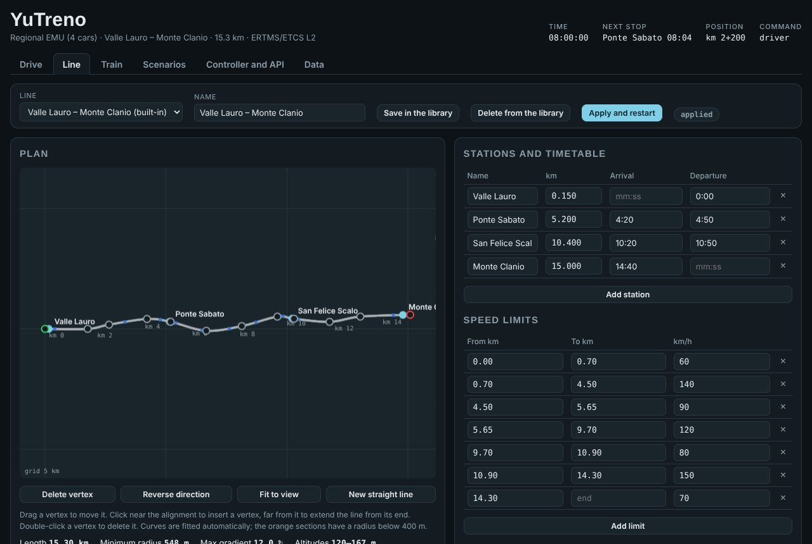 | 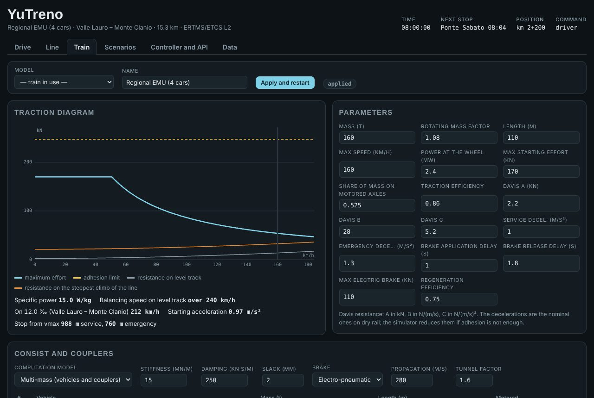 |
| 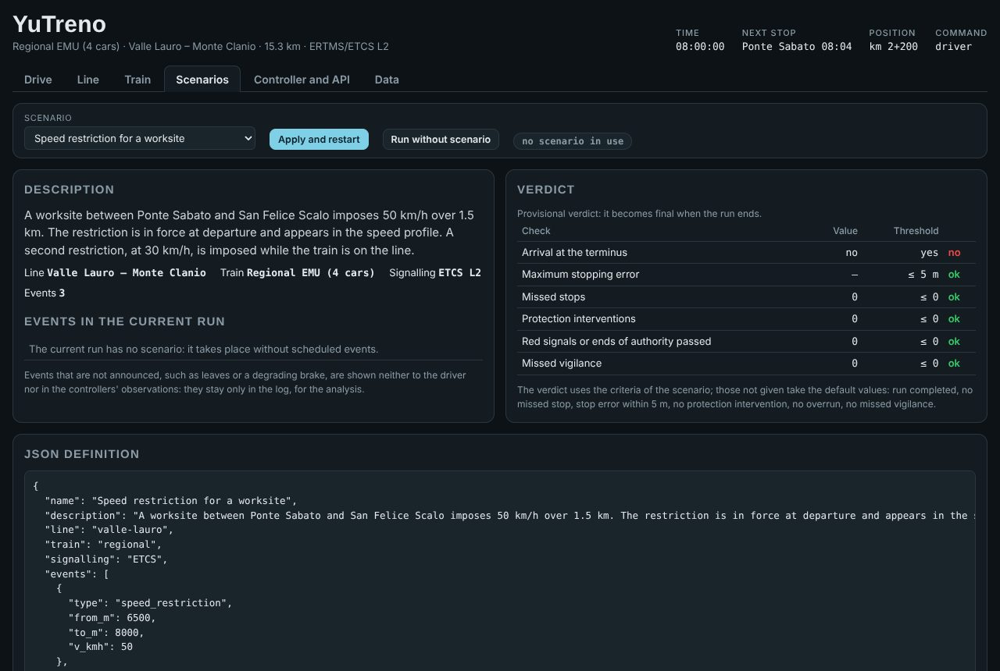 | 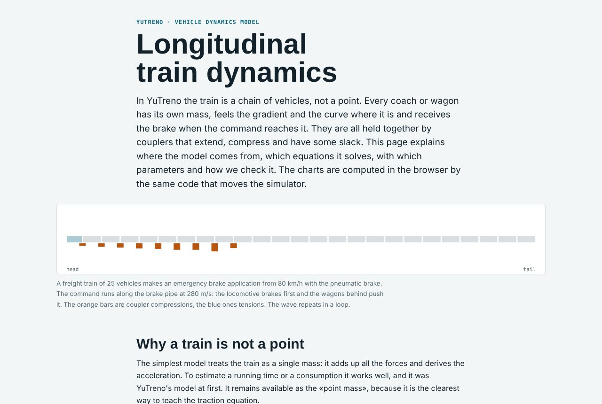 |
| 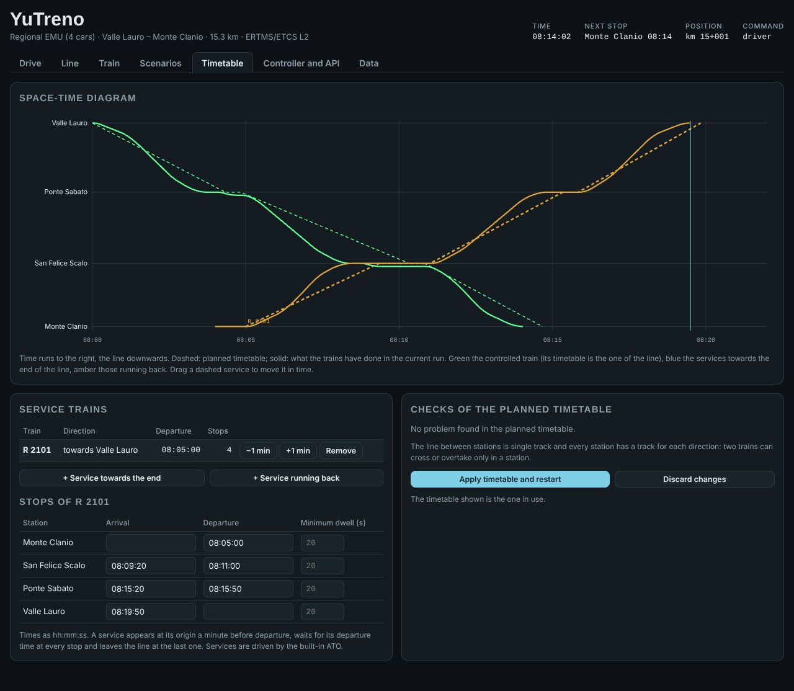 | 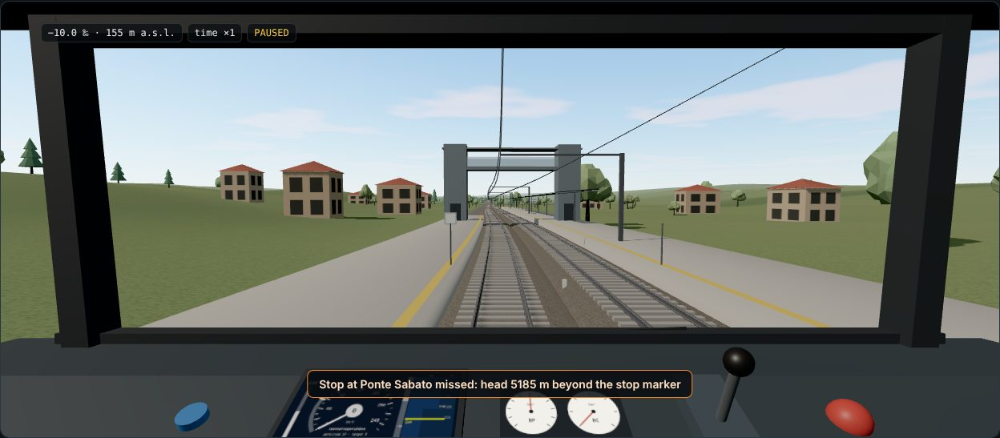 |

## Structure

| Folder | Content |
| :-- | :-- |
| `src/core/` | Simulation core, without browser or Node dependencies: line, network, trains, signalling and supervision, dynamics, reference onboard, field of the interlocking trackside, traffic of several trains, passengers, observation and command API, lockstep execution, control room snapshot, compatibility with the Italian names of version 0.x (`legacy.ts`) |
| `src/trackside/` | Trackside: interlocking, RBC, control table with the translator and protocol towards the engine; it does not depend on the engine |
| `src/regulator/` | The reference traffic regulator and its protocol; it does not depend on the engine |
| `src/feeds/` | Open data of a run (GTFS, GTFS-Realtime, SIRI, NeTEx, railML) and import of timetables |
| `src/infra/` | Import of a real line from OpenStreetMap, RINF and a terrain model |
| `src/web/` | Interface: 3D cab view (`view3d.ts`, Three.js) and 2D view, DMI, lever, editors, timetable, control room, in-browser controllers, audio, input devices |
| `src/server/` | Node tools: headless execution, bridge towards external programs, agent environment, open data server, importers, scenario maker |
| `examples/` | Example controllers (`ato.js`, `ato_s130.js` with the Subset-130 data, `example_controller.py`), external ETCS onboards (`onboard/`), the trackside and the regulator as external programs (`trackside/`, `regulator/`), external dynamics models (`dynamics_point.js`, `python/`, `octave/`, `matlab/`), an agent environment (`agents/`), scenario configurations, imported lines (`infra/`) and open data output (`feeds/`) |
| `scenarios/` | Event and fault scenarios with verdict criteria, used by the page and by headless runs; `scenarios/trackside/` those of the interlocking trackside, `scenarios/services/` those with service trains |
| `scripts/` | Build, checks `verify-*.ts`, golden masters of the runs and of the page, requirement traceability, measurement campaigns, curve validation |
| `golden/` | Fingerprints of the golden masters |
| `campaigns/` | Configurations of the measurement campaigns |
| `validation/` | Cases for the comparison with the ERA braking curves tool |
| `src/docs/` | Page describing the dynamics model, with charts and laboratory computed by the core |
| `docs/` | Guides, API, scenarios, model, standards, design documents, traceability; `docs/img/` contains the screenshots, `docs/it/` the Italian copies |

## Checks

`npm run verify` runs all the scripts `scripts/verify-*.ts`, two at a time (`-- --quick` only the short ones):

- `verify-line`: lengths of the built-in lines, profile, contiguous limits and signals consistent with the stations.
- `verify-physics`: braking distance, balancing speed, start on a climb, adhesion limit, with both dynamics models.
- `verify-dynamics`: multi-mass model compared with the two-mass toy train of Gîlcă and Borcoși, static equilibrium, brake propagation, convergence with the step, Röckl and Curtius-Kniffler.
- `verify-external-dynamics`: the point mass rewritten as an external model reproduces the internal one; determinism, requests and TCP transport.
- `verify-onboard`: balises, RBC messages, reference onboard on lines and scenarios, driver who never brakes, external onboard.
- `verify-subset026`: requirement-level tests of the reference onboard against Subset-026 and Subset-130, one block per group of clauses, in closed form where the clause gives a formula.
- `verify-ato-s130`: the API versions; `N_LOC_EBI` matches the point where the protection really intervenes; ATO data equal with the internal and external onboard; the Subset-130 ATO drives without interventions and consumes almost the same with both onboards.
- `verify-trackside`: translation of the control tables, interlocking against the field (setting, conflicting routes, delayed cancellation, failures, sectional release, trailed point), nominal runs and scenarios with the interlocking trackside, external trackside identical to the in-process one, overtaking on track II.
- `verify-curve-validation`: the curve validation tool reproduces the closed-form formulas on level track and puts the curves in the expected order.
- `verify-scenarios`: validation, merging of limits, verdict, effect of every event type, expected outcomes of the example scenarios and determinism.
- `verify-services`: service trains with a timetable: validation, departures on time, distance between trains, propagation of a delay with ETCS and with the automatic block, the mirrored line, crossings on single track (never two opposing trains on a section, a late train delays the opposite one), agents equal to the built-in ATO, determinism.
- `verify-regulator`: the regulator protocol, its decisions and their effects, the reference regulator on a breakdown and a blocked line, the external regulator identical to the in-process one.
- `verify-capacity`: the minimum headway between two identical trains within 5 % of the one computed from the blocking times, and the determinism of the whole chain.
- `verify-network`: networks and corridors, node routes, runs on networks with every trackside, regulator and reroutes.
- `verify-passengers`: conservation of the passengers, dwell, capacity, mass on board, determinism, occupancy in the open data.
- `verify-control-room`: the control room snapshot against the state of the engine, on a line and on a network.
- `verify-feeds` and `verify-imports`: the open data (structure, references, agreement between formats) and the round trip of timetables through GTFS, NeTEx and railML.
- `verify-infra`: the import of a real line from synthetic sources and from the real lines of `examples/infra/`.
- `verify-scenario-config`: scenarios from a short configuration, and the service campaign.
- `verify-ato`: the example controller runs all combinations of line and signalling without protection interventions. Stops must be within 3 m of the marker and two equal runs must give identical data. The results must match the reference values.
- `verify-traceability`: every implemented or simplified requirement of the matrix has at least one test, and the traceability files are up to date.

`npm run golden` runs every scenario in six variants of signalling, onboard, trackside and regulator, and the two campaigns, and fails if any part of any run changed; `scripts/page-golden.mjs` does the same for the page.

If a change alters the physics on purpose, the reference values in `scripts/verify-ato.ts` are updated in the same commit, explaining the reason in the message.

## Scenarios

A scenario prepares a run and schedules events by time or position:

- loss of the radio connection with the RBC;
- speed restrictions;
- zones of reduced adhesion;
- degraded brake or traction;
- train ahead stopped, a service train broken down, a blocked stretch of line;
- emergency stop;
- messages to the driver;
- commands of the dispatcher;
- with the interlocking trackside, failed points and track circuits and control centre commands.

A scenario can also have service trains with their timetable, a network, passengers and connections between trains.

At the end of the run the criteria of the scenario give a verdict, passed or failed, with the list of checks. Events that cannot be seen onboard, such as leaves or a degraded brake, are neither shown nor sent to the controllers. The format is described in [docs/SCENARIOS.md](docs/SCENARIOS.md).

## Compatibility with version 0.x

Up to version 0.1 every format of YuTreno used Italian names. They are still accepted: scenarios, lines, trains, CLI options (`--linea`, `--bordo`, `--terra`…), controllers that define `controllo(oss, mem)`, external programs that speak protocol version 1. The translation happens on input in `src/core/legacy.ts`, and external programs of version 0.x receive the Italian format with `--protocol 1`. See [docs/API.md](docs/API.md#versions).

## Next steps

Where the project stands and the roadmap from here are in [docs/STATE_OF_THE_ART.md](docs/STATE_OF_THE_ART.md); every step and decision is in [docs/ROADMAP.md](docs/ROADMAP.md). Among the things left: the RBC handover at a node and several RBCs on a network, an interlocking per station with flank protection, the moving block with the interlocking trackside, the validation of the onboard curves against the ERA tool, passengers who choose their route, snapshots and replay for the instructor, DMI iconography compliant with the ERA specifications, sessions with several users, and a physical model railway driven by YuTreno ([docs/PHYSICAL_MODEL.md](docs/PHYSICAL_MODEL.md)).

## Licence

Copyright 2026 Nicola Amatucci. The code is licensed under the [European Union Public Licence v. 1.2](LICENSE) (EUPL-1.2), the documentation under CC BY 4.0; the data of OpenStreetMap, RINF and EU-DEM in `examples/infra/` keep the licences of their sources. Details in [NOTICE.md](NOTICE.md). YuTreno was developed with an AI coding assistant under the direction of its author: see [docs/AI_USE.md](docs/AI_USE.md).

If you believe something in this repository infringes your copyright or is not credited properly, please [open an issue](../../issues/new?template=copyright.md): it will be answered and, where the concern is founded, the material removed or credited ([NOTICE.md](NOTICE.md#reporting-a-copyright-concern)).
