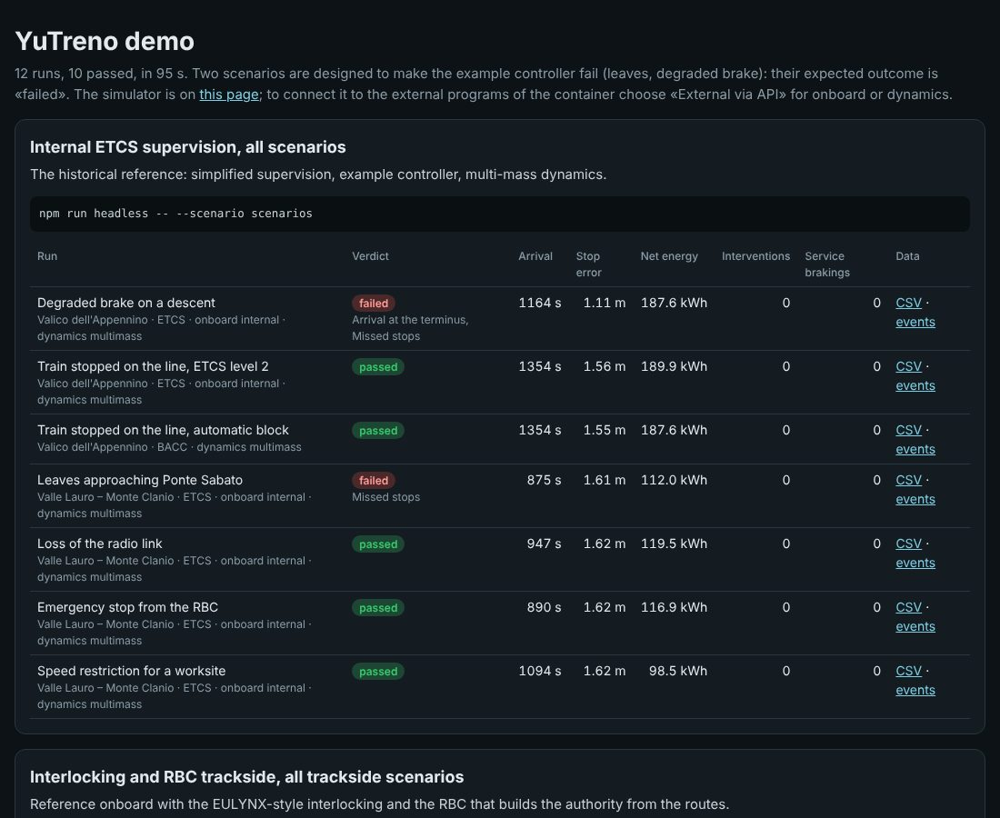

# YuTreno demo in Docker

This folder builds a complete test environment in a single container. Inside there are:
- the web simulator, already built;
- headless runs;
- the external ETCS onboards and dynamics models in Python and Octave;
- the bridges that connect the page to those programs;
- the compiled openETCS onboard computer code.

At start-up the container runs a test campaign and publishes a report. Then it stays up with the simulator and the bridges, so you can drive from the page with an external onboard and dynamics.

## Start

From the repository root:

```bash
docker build -f docker/Dockerfile -t yutreno-demo .
docker run --rm -p 8000:8000 -p 8766:8766 -p 8767:8767 yutreno-demo
```

Or, from the `docker/` folder:

```bash
docker compose up --build
```

The first build takes a few minutes. It downloads the Node dependencies and the system packages, then downloads and compiles openETCS: 1109 C files, about a minute. The image weighs around 2.5 GB with Octave and openETCS. With `--build-arg WITH_OCTAVE=0` and `--build-arg WITH_OPENETCS=0` it becomes much lighter, and the demo skips the corresponding parts.

At the end of the demo, which takes about eight minutes on a two-core machine, the container announces the addresses:
- **http://localhost:8000/** is the simulator, the same page as `dist/yutreno.html`;
- **http://localhost:8000/results/** is the report of the demo, with the verdict of every run and the links to CSV and events.

## What the demo does



The campaign (`demo.sh`) tests all the ways of connecting external programs to the engine, with the example automatic controller driving:

1. **Internal ETCS supervision**, all scenarios: the historical reference.
2. **Reference ETCS onboard**, all scenarios: Subset-026 balises and messages and braking curves of §3.13.
3. **External ETCS onboard in Python**, all scenarios: a minimal onboard computer started by YuTreno and connected on stdin/stdout.
4. **External dynamics in Python**, all scenarios.
5. **External dynamics in Octave**, one run on the Valle Lauro line.
6. **External onboard and dynamics together**, on the Appennino line: three programs coordinated by the engine (controller, onboard, dynamics).
7. **Interlocking and RBC trackside**, all the trackside scenarios with the reference onboard.
8. **The same trackside as an external program**, on stdin/stdout: the runs must be those of test 7.
9. **Service trains**, all the service scenarios: crossings, precedence, connections, a breakdown, a cancellation, a branch, the two real lines of Benevento as a network.
10. **External regulator in Python**, on the breakdown at San Felice Scalo.
11. **Human driver model** (`examples/driver_model.js`) in place of the automatic controller, with its three profiles, on the Appennino line.
12. **openETCS**: the minimal test of the compiled onboard computer.

Some runs fail on purpose, and the report marks them *failed, as expected*. The scenarios of the leaves and of the degraded brake are designed to put the example controller in difficulty. With the minimal Python onboard the odometry drift fails too: the onboard ignores the confidence interval of its position, so with the odometer reading 5 % less it passes its end of authority. Every run has one row for the controlled train; the other trains of the run (the freight train ahead, the services) are summed up under it. A failure that is not expected makes the demo end with an error.

## Driving with an external onboard and dynamics

With the container up there are two WebSocket bridges:
- **ws://localhost:8766** leads to the external dynamics in Python;
- **ws://localhost:8767** leads to the minimal ETCS onboard in Python.

They are the default addresses of the page, so it is enough to choose them:
- in the *Train* tab, the computation model *External via API*, then *Apply and restart*;
- in the bar above the cab, *ETCS onboard* → *External via API*.

The state of the two connections appears above the view. Every new run starts new external processes.

The page makes at most one exchange per frame with each external program. With both connected the run reaches at most about twice the real speed, even if a higher accelerated time is chosen.

The programs connected to the bridges are changed with environment variables. For example, to use the dynamics in Octave:

```bash
docker run --rm -p 8000:8000 -p 8766:8766 -p 8767:8767 \
  -e BRIDGE_DYNAMICS="octave-cli -q examples/octave/yutreno_dynamics.m" yutreno-demo
```

or, for the reference onboard of the core as an external process, `-e BRIDGE_ONBOARD="npx tsx examples/onboard/onboard_stdio.ts"`.

## Other modes

The last argument of `docker run` chooses what to do:

| Command | Effect |
| :-- | :-- |
| `all` (default) | demo, then simulator and bridges; with `-e DEMO=0` it skips the demo |
| `services` | only simulator and bridges |
| `demo` | only the campaign, then exits |
| `verify` | all the checks of the repository (`npm run verify`) |
| `openetcs` | the minimal test of the openETCS computer |
| `shell` | a shell in the container, in the repository folder |
| anything else | run as is |

For example:

```bash
docker run --rm yutreno-demo npx tsx src/server/headless.ts --line appennino --onboard reference
docker run --rm -v "$PWD/outcomes:/outcomes" -e RESULTS=/outcomes yutreno-demo demo      # report on disk
```

The compiled openETCS code is in `/opt/openetcs`:
- `test_evc` is the minimal test;
- `libopenetcs_evc.a` and `include/` are for writing the adapter described in `docs/EVC_GUIDE.md`;
- `trackside-simulator/` contains the packet conversion functions.

The Italian commands and variables of version 0.x (`tutto`, `servizi`, `verifica`, `PONTE_BORDO`, `PONTE_DINAMICA`, `WEB_PORTA`) are still accepted.

## Behind a proxy

If the network goes through a proxy that inspects HTTPS, its certificate must be put as a `.crt` file in `docker/certificates/`: it is installed before downloading anything. The proxy settings are passed to the build as usual:

```bash
docker build --build-arg HTTPS_PROXY=http://proxy:3128 -f docker/Dockerfile -t yutreno-demo .
```

The base image is `node:22-bookworm-slim`. If the Docker registry cannot be reached another one with Node 22 and apt can be given, with `--build-arg NODE_IMAGE=...`.
