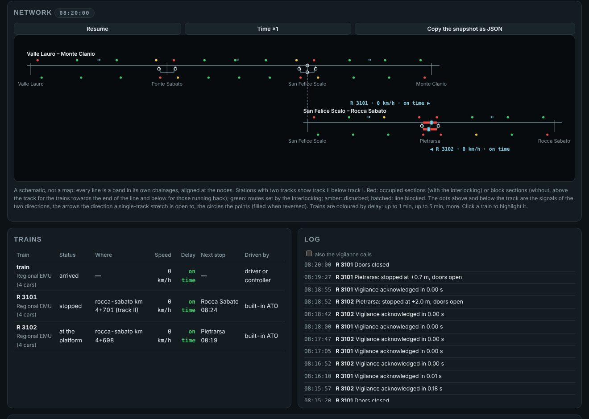

# Control room

The *Control room* tab of the page shows the traffic as an operator of a control centre sees it. It has a schematic of the whole network, a table of the trains, the log of the run and the commands that already exist. Its only source is a snapshot that the engine produces, `Simulation.controlRoom()`. The same snapshot is served by the open data server on `/control-room`, so an external program, a regulator or a dashboard for example, sees exactly what the page shows.

Italian copy: [it/SALA_CONTROLLO.md](it/SALA_CONTROLLO.md).



## What it shows

**The schematic.** It is a topological diagram, not a map, like the mimic panels and screens of a control centre. Every line is a horizontal band drawn in its own chainages. The bands are placed from the main line outwards along the nodes, and each one is shifted so that its node falls at the same abscissa as on the line it joins. A dashed connector joins the two points of every node; where a loop closes, as with the link Ponte Sabato – Pietrarsa, the connector is slanted. Nothing is drawn by hand, so the same code draws the imported networks too, such as Cancello – Benevento with Avellino – Benevento.

On every band the schematic shows:
- the stations, with track II below track I in those that have two tracks;
- the signals of the two directions, above the track for the trains towards the end of the line and below it for those running back, coloured by aspect (on ETCS level 2 they are the marker boards, coloured as the block behind them);
- the occupation: without the interlocking, the block sections each direction sees occupied, above and below the track; with the interlocking, the track circuits the trackside reports occupied (red) or disturbed (amber), on the track they belong to;
- with the interlocking, the routes set or in use (green) and the points, filled when reversed;
- the direction each single-track stretch is open to: the orientation of the engine, or the block consent of the interlocking;
- the stretches blocked by a disruption, hatched;
- with passengers ([PASSENGERS.md](PASSENGERS.md)), the people waiting at every station;
- with the trackside of the engine on a network, the node routes and the train holding them.

**The trains.** Each train is drawn on every line it occupies, from its tail to its head, on track II when it is there. The label at the head gives its number, speed and delay. The train and its label are coloured by delay: up to one minute, up to five, more. Clicking a train highlights it on the schematic and in the table.

**The table of the trains.** Each row gives the status of the train (not yet on the line, running, stopped, at the platform, broken down, cancelled, arrived), where it is, its speed, its delay, its next stop with the planned time (and the new one when the regulator changed it), and who drives it. The service of the same block it becomes and the connections it waits for are shown when there are any. With passengers a column gives the people on board, the seats and standing places and how full the train is. Clicking a train in the table or on the schematic also highlights it in the space-time diagram of the *Timetable* tab.

**The log.** It lists the events of all the trains in the order they happened: disruptions, decisions of the regulator, connections, protection interventions, stops. The vigilance calls are hidden unless asked for.

**The commands.** The page sends only commands that already exist. It has pause and the time speed. With the interlocking trackside it also has the control centre commands: automatic route setting on and off, the emergency stop of all trains, setting a free route and cancelling one in use. The interlocking decides; the page only sends.

## The dispatcher

Below the log, the *Dispatcher* panel gives the decisions of a traffic regulator by hand. Click a train, then hold it two minutes at its next stop (`retime`), skip its next stop (`skip_stop`), end it there (`cancel`) or give it priority in conflicts (`priority`). A temporary speed restriction on the main line is put in force or revoked from a chainage to another, and every train sees it through its own signalling (the ETCS authority or the restriction of the automatic block). The page only sends the command: the engine applies it or says why it cannot (a train already gone, a stop that is the origin, the controlled train, which keeps the stops of its line), and writes it in the log.

The commands come to the engine through `Simulation.dispatch(c)`, which also a program can call: `c` is a command of the regulator protocol ([REGULATOR.md](REGULATOR.md)) or `{ type: 'speed_restriction', from_m, to_m, v_kmh, revoke? }`, and the return is null or the reason of the refusal. Every command applied is recorded with its time in `Simulation.dispatched`, which the panel shows and copies as JSON: giving the same commands at the same times repeats the run exactly. *Write into the scenario* puts them, as `dispatch` events (`withDispatched(def, sim.dispatched)`), into the JSON of the Scenario tab: applied there, the scenario gives them again at their times and the run is the one in which they were given live (`CR3`). The commands that came from the scenario replace its `dispatch` events, so writing again after a repeated run does not double them.

## The snapshot

`Simulation.controlRoom(logLimit = 200)` returns a `ControlRoomSnapshot` (`src/core/control-room.ts`). It is a public interface like the protocols: names are English, the version is in `version` (now 1), and it only grows with optional fields. Chainages are those of each line, in metres from its origin, and a direction +1 runs towards the end of the line. In the example the arrays are cut and the values only illustrate the format.

```json
{ "type": "control_room", "version": 1, "t_s": 1000, "signalling": "ETCS", "trackside": "interlocking",
  "network": { "name": "...", "nodes": [ { "name": "San Felice Scalo", "lines": ["valle-lauro", "rocca-sabato"] } ],
    "lines": [ { "id": "valle-lauro", "name": "...", "length_m": 15300,
      "stations": [ { "name": "Ponte Sabato", "s_m": 5200, "tracks": 2 } ], "directions": [1, -1],
      "signals": [ { "id": "4", "s_m": 4950, "dir": 1, "kind": "H", "aspect": "Y" } ],
      "blocks": [ { "from_m": 400, "to_m": 1866.7, "dir": 1, "occupied": true } ],
      "single_track": [ { "from_m": 400, "to_m": 4950, "orientation": 1 } ], "blocked": [],
      "sections": [ { "id": "Ponte Sabato/1PZ", "from_m": 4900, "to_m": 4940, "track": "*", "state": "vacant", "locked": false } ],
      "points": [ { "id": "Ponte Sabato/1", "s_m": 4900, "track": "II:Ponte Sabato", "position": "N", "locked": false, "fault": false } ],
      "routes": [ { "id": "Ponte Sabato/1", "name": "Entry to Ponte Sabato on track I", "from_m": 4950, "to_m": 5450, "dir": 1, "state": "set", "track_from": "I", "track_to": "I" } ] } ] },
  "trains": [ { "id": "R 3101", "train": "Regional EMU (4 cars)", "driver": "ato", "status": "running", "route": ["valle-lauro", "rocca-sabato"],
    "line": "rocca-sabato", "dir": 1, "s_m": 2310.4, "occupies": [ { "line": "rocca-sabato", "from_m": 2210.4, "to_m": 2310.4 } ],
    "v_kmh": 98.2, "delay_s": 21.3, "next_stop": { "station": "Pietrarsa", "planned_arrival_s": 1170, "arrival_s": 1170 }, "track": null } ],
  "log": [ { "t_s": 999.2, "train": "R 3101", "kind": "INFO", "text": "..." } ],
  "panel": { "ars": true, "routes": [], "points": [], "tvps": [], "ma": null, "speed_restrictions": [] } }
```

- `network.lines[]`: stations with their number of tracks; the directions some train runs along; the signals and the block sections of each of those directions, with the aspects and the occupation the signals see; the single-track stretches with their orientation (+1, −1, 0 free, null where nothing orients them); the stretches blocked by a disruption. With the trackside of the engine on a network, `node_routes`. With the interlocking trackside, `sections`, `points` and `routes` (the routes that are not free, except the automatic block routes).
- `trains[]`: one per train of the run, also those not yet on the line or already arrived (with `line` null). `line`, `dir` and `s_m` locate the head, `occupies` the stretch of every line the train is on. `delay_s` is the delay at the last stop served, against the planned timetable, as in the regulator protocol. `track` (interlocking) is `II` while the train is on a passing track.
- with passengers ([PASSENGERS.md](PASSENGERS.md)), two optional fields: `waiting` on every station of a line, the people on its platforms, and `passengers` on every train, `{ onboard, seats, standing, occupancy }` with the occupancy level of SIRI. Reading them does not change the run, also with Poisson arrivals: the people arrived since a train last called are counted at their expected number until the next call.
- `log`: the last `logLimit` events of all the trains, oldest first.
- `panel`: with the interlocking trackside, the panel of the control centre as the trackside returned it.

The snapshot is a function of the state of the run: it reads and never changes anything, so two equal runs give equal snapshots.

The open data server serves it on `GET /control-room` (`?log=<n>` for the number of events), and `npm run feeds -- --at <s> --out <folder>` writes it as `control-room.json` beside the feeds.

## Checks

`scripts/verify-control-room.ts` takes a snapshot every 10 s of simulated time on four runs: the crossing on one line with the automatic block and with the interlocking, and the branch with the automatic block and with the interlocking. It checks:
- every line of the network, and the signals with the aspects and the positions of the directed lines;
- with the interlocking, the state of every section as the field sees it, except those that changed within the last trackside cycle (the panel is one cycle behind);
- every train in the table; every active train on the schematic, on the line of its head with its chainage and speed, also off the main line; the block section under its head occupied;
- the delays against the timetable of the run, and the log in order;
- determinism: two equal runs give the same snapshots.

`scripts/control-room-shots.mjs` (Playwright, not among the dependencies) opens the page with every included scenario, advances the run, opens the control room and saves a screenshot. It fails if the page reports an error or an active train is missing from the schematic. With `--interlocking` it runs every scenario with the reference onboard and the interlocking trackside.

**Page checks of phase 7.** `scripts/page-checks.mjs` (Playwright, as above) makes a scenario with passengers from the form of the *Scenarios* tab, checks the passenger chip at a stop, the people waiting and on board in the control room, the highlight of a train in the space-time diagram, riding in the cab of a train in each direction and a scenario with the real timetable of Salerno – Mercato San Severino, and saves screenshots.

`verify-control-room` (`CR2`) gives a restriction (the following train keeps under it), holds a train, skips a stop, checks three refusals and their reasons, and repeats the run from the record of the commands.

## Limits

- The schematic draws the stations as they are generated today: track I and track II between the points, without the geometry of the points. The track circuits and the points come from the trackside, so a station with other tracks will be drawn from its data.
- The *Dispatcher* panel gives only some of the decisions a regulator can take: hold, skip a stop, end at the next stop, priority and speed restrictions. A track, a reroute or a connection are given from a program through `Simulation.dispatch()`.
