# User guide

YuTreno opens in the browser: locally with `npm run dev`, or with a double click on `dist/yutreno.html` after `npm run build`. Neither a server nor a connection is needed. The chosen configuration (line, train, conditions, view) stays saved in the browser for the next time; a configuration saved by version 0.x, with Italian names, is translated when it is read.

The page has eight tabs. *Drive* is the cab. *Line* and *Train* are the two editors. *Scenarios* prepares runs with events and faults and shows their verdict. *Timetable* adds other trains with their timetable and shows the space-time diagram. *Control room* shows the whole network with its trains. *Controller and API* hands driving over to an algorithm. *Data* collects the logs of the run.

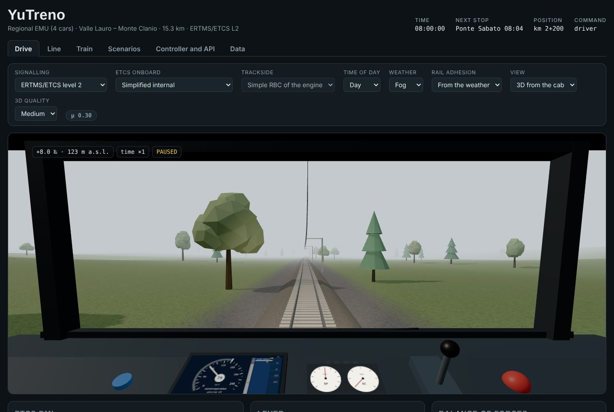

## Driving

Every run starts at standstill, with a briefing that gives line, train, timetable and conditions. Close the briefing and move the lever to traction. The lever has eighteen positions plus emergency: ten traction steps, neutral and seven service braking steps.

| Key | Action |
| :-- | :-- |
| ↑ or W | lever towards traction |
| ↓ or S | lever towards braking |
| N | neutral |
| Space | vigilance acknowledgement |
| E | emergency braking |
| P | pause |
| T | speeds up time (×1, ×2, ×4, ×8) |
| M | audio on or off |

With a standard controller the d-pad moves the lever, A acknowledges the vigilance, B commands the emergency brake and Start pauses. A USB lever is calibrated with the *Calibrate physical lever* button of the *Drive* tab. The same commands are also buttons in the lever panel, below the view, useful on phones and tablets.

The goal is to reach the terminus respecting the timetable and stopping at every station with the head of the train within 20 m of the stop marker, without the protection intervening. In stations the doors stay open for at least 20 seconds and until the timetabled departure, longer if passengers are still boarding, and traction is inhibited until they close. While running, the vigilance asks for an acknowledgement every 55 seconds: if it does not arrive within 5 seconds the emergency brake is applied.

## The cab

The 3D view puts the driver at the desk. In the middle there is the DMI, the same one drawn in the panel below the view. Next to it there are the gauges of the brake pipe (BP) and of the brake cylinders (BC), the lever that follows the chosen position, the blue vigilance button, which flashes when it asks for an acknowledgement, and the red emergency mushroom. The lamps above the gauges show vigilance, doors, wheel slip and emergency. With rain the wiper moves; at night and in tunnels the headlights and the cab light turn on.

Through the windscreen you see the line as it was drawn, with curves, gradients and tunnels with their portals, and the stations with platforms, shelters, building and name board. There are also the catenary, the kilometre posts, the lineside signals of the automatic block or the ETCS stop marker boards and the train ahead, with its red tail lights.

| | |
| :-: | :-: |
| 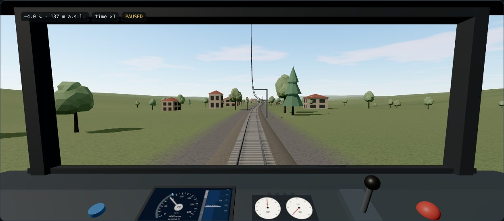 | 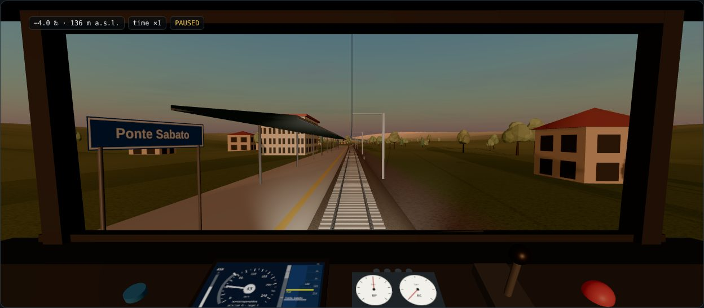 |
| 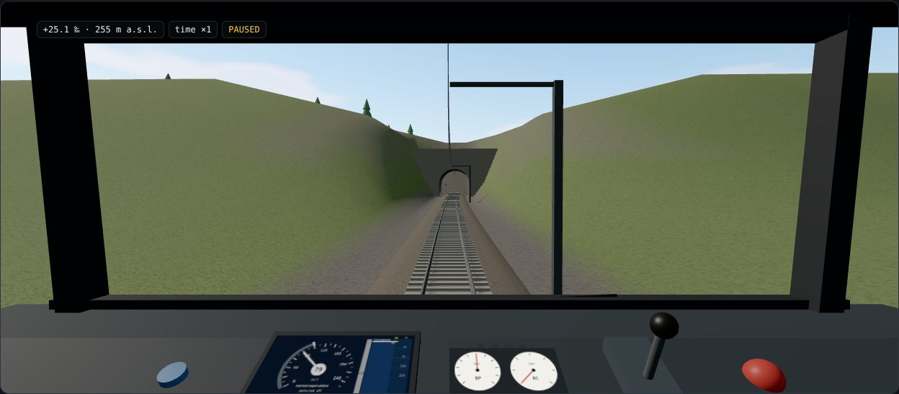 | 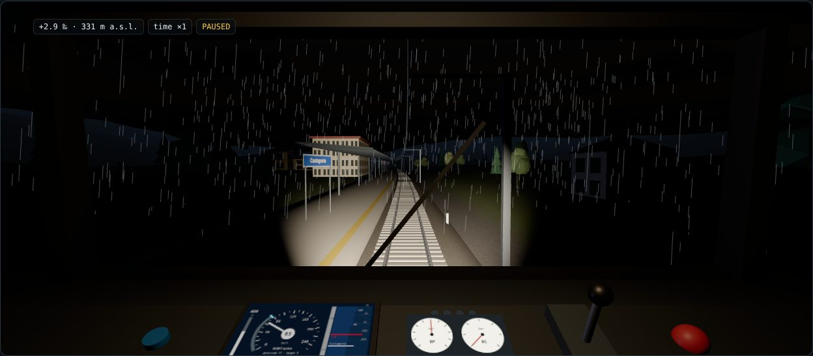 |

In the bar above the view you choose the view and the graphics quality. The *Essential 2D* view is lighter and remains available when the browser does not support WebGL. The *Low* quality removes the shadows and thins out trees and sleepers; on phones it is the initial choice. If the system asks to reduce motion, the camera does not sway and the wiper stays still.

*Ride in* puts the 3D view in the cab of another train of the run, on any line of the network: when the train is on another line the world is built from that line, and the chip names it. You see the line from there, also running back, and a chip gives its number, speed and next stop. You keep driving your own train with the lever and the DMI below, and your train is drawn on the line like the others. With passengers the passenger chip follows the train you ride in, and the platforms show the people waiting, one figure per person up to 60 per platform.

## Conditions

In the same bar you choose the signalling. With **ERTMS/ETCS level 2** there are no lineside signals: the DMI shows the permitted speed, the distance to the target and the supervision curves. First come indication and warning, then the service braking commanded by the onboard and, if that is not enough, the emergency brake. With the **automatic block and SCMT** you drive by the signals, which have three aspects, and SCMT intervenes only if you exceed the curve towards a red signal.

With ETCS the *ETCS onboard* entry chooses who does the supervision. *Simplified internal* is the original one. *Reference, balises and messages* makes the RBC speak with the messages of the specification and uses an onboard computer with the curves of Subset-026. *External via API* connects an external onboard computer, at the address that appears next to it. The details are in [ONBOARD_ETCS.md](ONBOARD_ETCS.md).

With a message-based onboard you can also choose the *Trackside*. *Simple RBC of the engine* is the original one. *Interlocking and RBC* makes the authority come from the routes of an interlocking, with points and track circuits. Below the line diagram the **control centre panel** then appears. For every station it shows the routes with their state and a button to set or cancel them, the points with their position and locking, the track circuits occupied or failed. At the top there are the end of authority sent to the train, the switch for automatic route setting and the emergency stop. The details are in [TRACKSIDE.md](TRACKSIDE.md).

Time of day and weather change light, fog and rain. The rail adhesion, derived from the weather or chosen by hand, changes braking distances and the traction available on climbs. On rails with leaves the train slips easily.

## Lines and trains

In the *Line* tab you draw the plan by dragging the vertices, edit the altitude profile and fill in stations, timetable, speed limits and tunnels. Lines are saved in the browser library and exported as JSON. *Apply and restart* starts a run on the modified line.

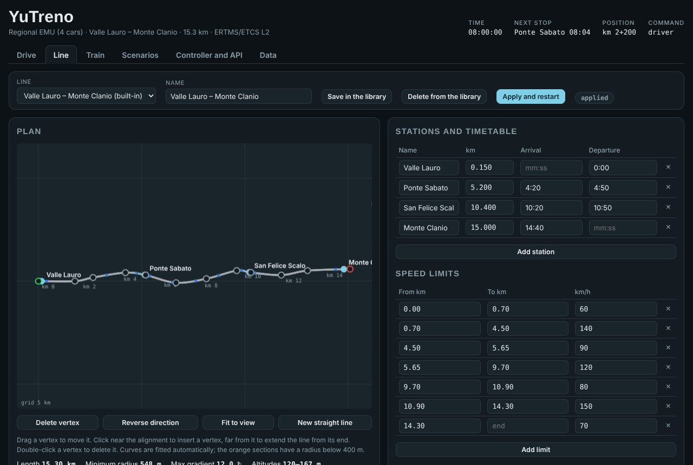

In the *Train* tab you choose a built-in model (regional, high speed, freight) and its parameters: masses, effort and power, running resistances, braking. You also choose the computation model. The *multi-mass* model simulates every vehicle and every coupler; the *point mass* is simpler and suited to teaching. The forces along the train during the run are shown in the *Forces along the train* panel of the *Drive* tab. The page `dist/model.html` explains the model with equations and an interactive laboratory.

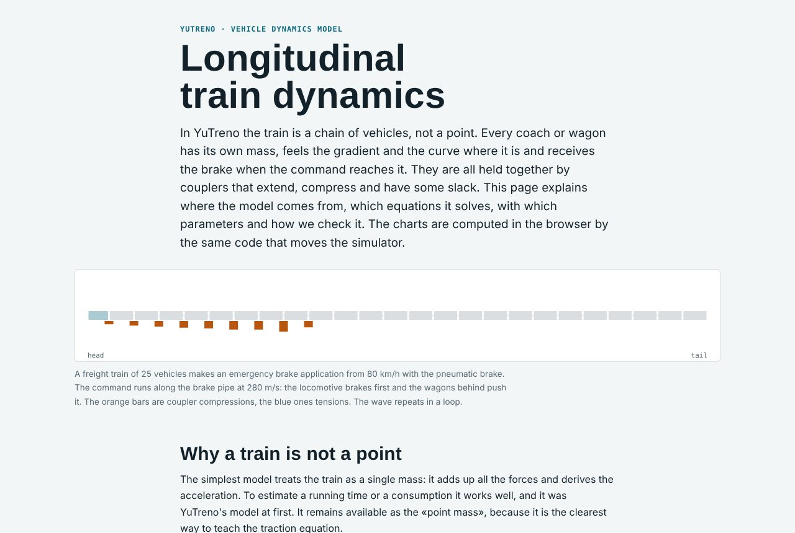

The third computation model, *External via API*, has the dynamics computed by an external program, for example MATLAB/Simulink. The page queries it at every coupling interval, at the address given next to the choice of the model. How to connect it is explained in [EXTERNAL_DYNAMICS.md](EXTERNAL_DYNAMICS.md).

## Scenarios

A scenario prepares the run and schedules events by time or position: radio loss, speed restrictions, leaves, degraded brake or traction, train ahead stopped, a service train broken down, a blocked stretch of line, emergency stop, messages, commands of the dispatcher and, with the interlocking trackside, failed points and track circuits and control centre commands. At the end its criteria give a verdict, passed or failed, with the detail of the checks. Some events are announced in the cab; others, like a degrading brake, are discovered only from their effects. The format and the example scenarios are described in [SCENARIOS.md](SCENARIOS.md); [SCENARIO_GUIDE.md](SCENARIO_GUIDE.md) walks through writing one from scratch.

**Make a scenario.** At the top of the tab a form makes a scenario without writing JSON: a line (the one in use, a built-in one or one of the real lines of `examples/infra`), how many service trains, every how many minutes and in which directions, and how many passengers an hour leave each station, as a continuous flow or at random. For Salerno – Mercato San Severino the trains can be those of its real timetable, from a chosen time. The form uses the same scenario configuration as the command line ([SCENARIO_CONFIG.md](SCENARIO_CONFIG.md)).

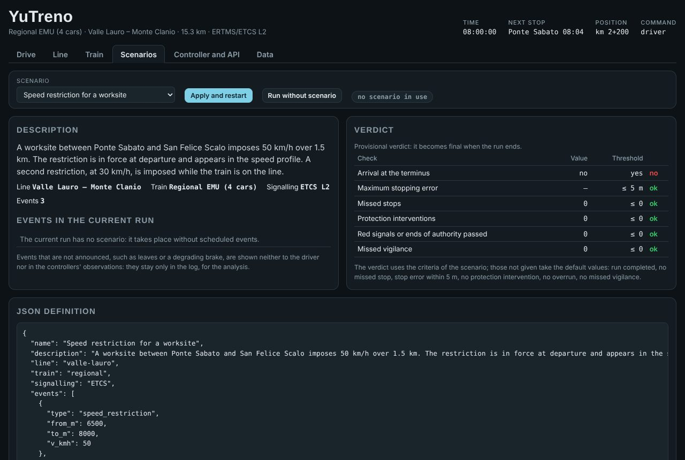

## Timetable and other trains

The *Timetable* tab adds service trains to the run: other trains with their stops and times, driven by the built-in ATO, in the direction of the line or running back. The line between stations is single track and every station has two tracks and two platforms joined by a footbridge, so trains cross and overtake in stations; between stations each section is given to one direction at a time. The other trains appear on the line diagram of the *Drive* tab (blue towards the end of the line, amber running back) and in the 3D view, where the trains running back stop on the second track.

The space-time diagram has time to the right and the line downwards: dashed the planned timetable, solid what the trains have done in the current run, in green the controlled train. A service is added with the two buttons, edited in the table of its stops (times as hh:mm:ss, minimum dwell) or moved in time by dragging its dashed line. The checks list dwells shorter than the minimum and crossings or overtakings planned between stations, where the single track does not allow them. *Apply timetable and restart* puts the services in the scenario in use. The format is described in [SCENARIOS.md](SCENARIOS.md#service-trains).

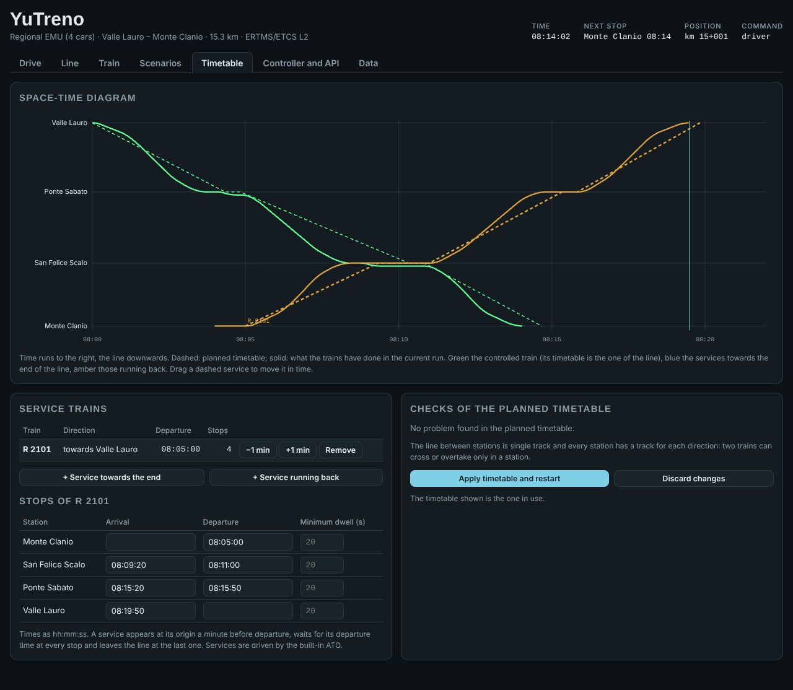

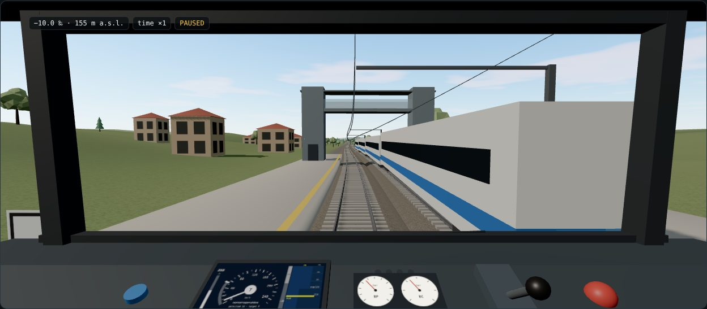

## Control room

The *Control room* tab shows the traffic as a control centre sees it: a schematic of the whole network with signals, occupied sections, the direction of every single-track stretch and the trains coloured by delay; a table of the trains with their status, delay and next stop; the log of the run. With the interlocking trackside it also shows routes and points and has the commands of the control centre. Every train is on the schematic, also when it runs on a line other than the main one. With passengers the schematic gives the people waiting at every station and the table those on board of every train. A train clicked in the control room is highlighted in the space-time diagram. The *Dispatcher* panel gives the clicked train a hold of two minutes at its next stop, makes it skip that stop or end there, gives it priority, and puts in force or revokes a speed restriction on the main line; the engine applies a command or says why it cannot, and *Write into the scenario* turns the commands given into events of the scenario, so the run can be repeated. Details in [CONTROL_ROOM.md](CONTROL_ROOM.md).

**Passengers in the cab.** With passengers a chip at the top of the view gives, at a stop, how many alight and board and the seconds of boarding left (the doors stay open until then), and while running how many are on board. The summary at the end of the run adds the passengers carried, their wait, journey and delay and the energy per passenger-km ([PASSENGERS.md](PASSENGERS.md)).

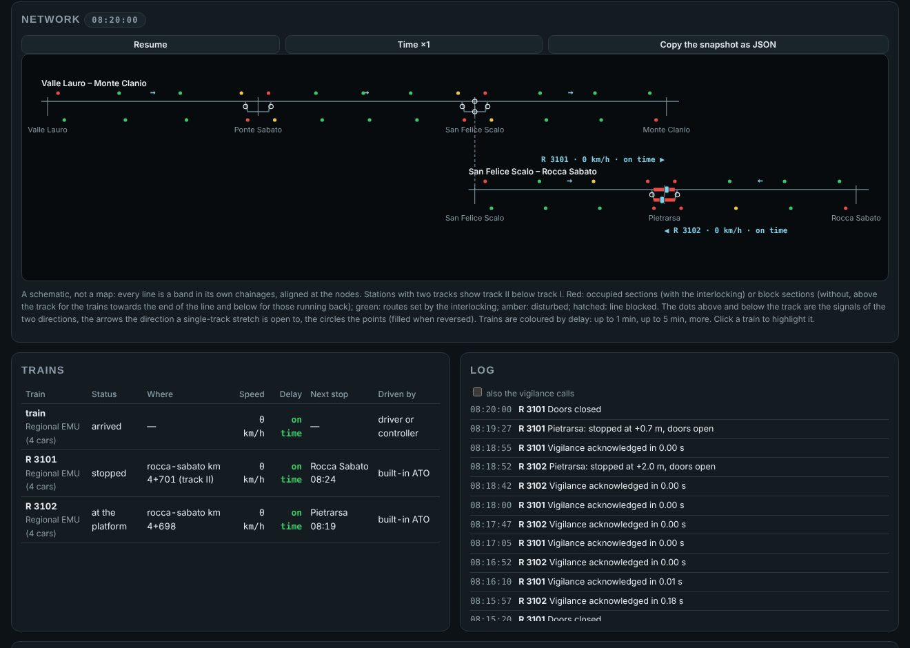

## Automatic driving

In the *Controller and API* tab you can write a controller in JavaScript, which runs in an isolated Web Worker, or connect an external program via WebSocket, in any language. In both cases the simulation stops at every control period, sends what the driver would see and resumes only when the command arrives, so the result does not depend on the speed of the computer. Moving the lever by hand takes back the command. The protocol is in [API.md](API.md).

The editor starts with the simple example ATO. The *Subset-130 example* button loads instead an ATO that uses the onboard data for ATO, such as the location of the intervention limit and the safe deceleration, and plans braking without following the permitted curve. *Restore example* goes back to the simple ATO. A controller written for version 0.x, which defines `controllo(oss, mem)`, still works and receives the observation with the Italian names.

## Run data

The *Data* tab collects the run indicators, the list of stops with their error and the event log. From here the events and the CSV are copied to the clipboard; the CSV has one row every half second with position, speed, forces, energy, supervision state and couplers. At the end of the run the report with the verdict appears. The same runs are repeated without graphics with `npm run headless`, also in series on all the scenarios.
