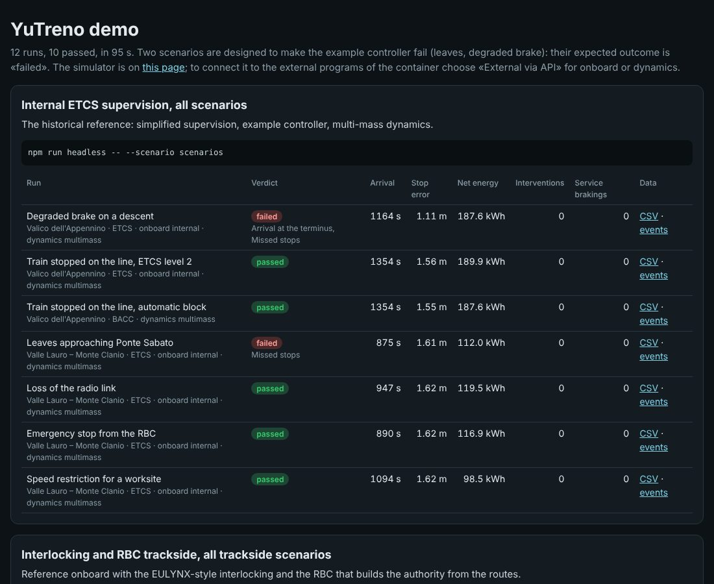

# Demo di YuTreno in Docker

> Copia italiana. Il documento di riferimento è la versione inglese [docker/README.md](../../docker/README.md): nomi di file, comandi e formati seguono quella; i nomi italiani della versione 0.x (campi JSON, opzioni come `--linea` o `--bordo`) restano accettati.

Questa cartella costruisce un ambiente di prova completo in un solo container. Dentro ci sono:
- il simulatore web, già compilato;
- le corse senza grafica;
- i bordi ETCS e i modelli di dinamica esterni in Python e in Octave;
- i ponti che collegano la pagina a quei programmi;
- il codice del calcolatore di bordo openETCS compilato.

All'avvio il container esegue una campagna di prove e pubblica un rapporto. Poi resta acceso con il simulatore e i ponti, così si può guidare dalla pagina con un bordo e una dinamica esterni.

## Avvio

Dalla radice del repository:

```bash
docker build -f docker/Dockerfile -t yutreno-demo .
docker run --rm -p 8000:8000 -p 8766:8766 -p 8767:8767 yutreno-demo
```

Oppure, dalla cartella `docker/`:

```bash
docker compose up --build
```

La prima build richiede qualche minuto. Scarica le dipendenze di Node e i pacchetti di sistema, poi scarica e compila openETCS: 1109 file C, circa un minuto. L'immagine pesa intorno ai 2,5 GB con Octave e openETCS. Con `--build-arg WITH_OCTAVE=0` e `--build-arg WITH_OPENETCS=0` diventa molto più leggera, e la demo salta le parti corrispondenti.

Al termine della demo, che dura circa otto minuti su una macchina a due core, il container annuncia gli indirizzi:
- **http://localhost:8000/** è il simulatore, la stessa pagina di `dist/yutreno.html`;
- **http://localhost:8000/results/** è il rapporto della demo, con il verdetto di ogni corsa e i collegamenti a CSV ed eventi.

## Cosa fa la demo




La campagna (`demo.sh`) mette alla prova tutti i modi di collegare programmi esterni al motore, con il controllore automatico di esempio alla guida:

1. **Supervisione ETCS interna**, tutti gli scenari: il riferimento storico.
2. **Bordo ETCS di riferimento**, tutti gli scenari: boe e messaggi del Subset-026 e curve di frenatura del §3.13.
3. **Bordo ETCS esterno in Python**, tutti gli scenari: un calcolatore di bordo minimo avviato da YuTreno e collegato su stdin/stdout.
4. **Dinamica esterna in Python**, tutti gli scenari.
5. **Dinamica esterna in Octave**, una corsa sulla linea Valle Lauro.
6. **Bordo e dinamica esterni insieme**, sulla linea dell'Appennino: tre programmi coordinati dal motore (controllore, bordo, dinamica).
7. **Terra con apparato e RBC**, tutti gli scenari della terra con il bordo di riferimento.
8. **La stessa terra come programma esterno**, su stdin/stdout: le corse devono essere quelle della prova 7.
9. **Treni di servizio**, tutti gli scenari dei servizi: incroci, precedenze, coincidenze, un guasto, una soppressione, una diramazione, le due linee reali di Benevento come rete.
10. **Regolatore esterno in Python**, sul guasto a San Felice Scalo.
11. **Modello di macchinista umano** (`examples/driver_model.js`) al posto del controllore automatico, con i suoi tre profili, sulla linea dell'Appennino.
12. **openETCS**: la prova minima del calcolatore di bordo compilato.

Alcune corse falliscono di proposito, e il rapporto le segna *failed, as expected*. Gli scenari delle foglie e del freno degradato sono pensati per mettere in difficoltà il controllore di esempio. Con il bordo minimo in Python fallisce anche la deriva dell'odometria: il bordo ignora l'intervallo di confidenza della sua posizione, quindi con l'odometro che segna il 5 % in meno supera la sua fine dell'autorizzazione. Ogni corsa ha una riga per il treno comandato; gli altri treni della corsa (il merci che precede, i servizi) sono riassunti sotto. Un fallimento non atteso fa finire la demo con un errore.

## Guidare con bordo e dinamica esterni

Con il container acceso ci sono due ponti WebSocket:
- **ws://localhost:8766** porta alla dinamica esterna in Python;
- **ws://localhost:8767** porta al bordo ETCS minimo in Python.

Sono gli indirizzi predefiniti della pagina, quindi basta sceglierli:
- nella scheda *Train*, il modello di calcolo *External via API*, poi *Apply and restart*;
- nella barra sopra la cabina, *ETCS onboard* → *External via API*.

Lo stato dei due collegamenti compare sopra la vista. Ogni nuova corsa avvia nuovi processi esterni.

La pagina fa al massimo uno scambio per fotogramma con ciascun programma esterno. Con entrambi collegati la corsa arriva al massimo a circa il doppio della velocità reale, anche se si sceglie un tempo accelerato più alto.

I programmi collegati ai ponti si cambiano con le variabili d'ambiente. Per esempio, per usare la dinamica in Octave:

```bash
docker run --rm -p 8000:8000 -p 8766:8766 -p 8767:8767 \
  -e BRIDGE_DYNAMICS="octave-cli -q examples/octave/yutreno_dynamics.m" yutreno-demo
```

oppure, per il bordo di riferimento del nucleo come processo esterno, `-e BRIDGE_ONBOARD="npx tsx examples/onboard/onboard_stdio.ts"`.

## Altre modalità

L'ultimo argomento di `docker run` sceglie cosa fare:

| Comando | Effetto |
| :-- | :-- |
| `all` (predefinito) | demo, poi simulatore e ponti; con `-e DEMO=0` salta la demo |
| `services` | solo simulatore e ponti |
| `demo` | solo la campagna, poi esce |
| `verify` | tutte le verifiche del repository (`npm run verify`) |
| `openetcs` | la prova minima del calcolatore openETCS |
| `shell` | una shell nel container, nella cartella del repository |
| qualsiasi altro | eseguito così com'è |

Per esempio:

```bash
docker run --rm yutreno-demo npx tsx src/server/headless.ts --line appennino --onboard reference
docker run --rm -v "$PWD/outcomes:/outcomes" -e RESULTS=/outcomes yutreno-demo demo      # rapporto sul disco
```

Il codice di openETCS compilato è in `/opt/openetcs`:
- `test_evc` è la prova minima;
- `libopenetcs_evc.a` e `include/` servono per scrivere l'adattatore descritto in [GUIDA_EVC.md](GUIDA_EVC.md);
- `trackside-simulator/` contiene le funzioni di conversione dei pacchetti.

I comandi e le variabili italiane della versione 0.x (`tutto`, `servizi`, `verifica`, `PONTE_BORDO`, `PONTE_DINAMICA`, `WEB_PORTA`) sono ancora accettati.

## Dietro un proxy

Se la rete passa da un proxy che ispeziona HTTPS, il suo certificato va messo come file `.crt` in `docker/certificates/`: viene installato prima di scaricare qualsiasi cosa. Le impostazioni del proxy si passano alla build come di consueto:

```bash
docker build --build-arg HTTPS_PROXY=http://proxy:3128 -f docker/Dockerfile -t yutreno-demo .
```

L'immagine di partenza è `node:22-bookworm-slim`. Se il registro Docker non è raggiungibile se ne può indicare un'altra con Node 22 e apt, con `--build-arg NODE_IMAGE=...`.
