# Guida d'uso

> Copia italiana. Il documento di riferimento è la versione inglese [GUIDE.md](../GUIDE.md): nomi di file, comandi e formati seguono quella; i nomi italiani della versione 0.x (campi JSON, opzioni come `--linea` o `--bordo`) restano accettati. La pagina è in inglese, quindi le voci dell'interfaccia sono scritte qui come compaiono sullo schermo.

YuTreno si apre nel browser: in locale con `npm run dev`, oppure con un doppio clic su `dist/yutreno.html` dopo `npm run build`. Non serve un server né una connessione. La configurazione scelta (linea, treno, condizioni, vista) resta salvata nel browser per la volta successiva; una configurazione salvata dalla versione 0.x, con i nomi italiani, viene tradotta quando si legge.

La pagina ha otto schede. *Drive* è la cabina. *Line* e *Train* sono i due editor. *Scenarios* prepara corse con eventi e guasti e ne mostra il verdetto. *Timetable* aggiunge altri treni con il loro orario e mostra il grafico spazio-tempo. *Control room* mostra tutta la rete con i suoi treni. *Controller and API* affida la guida a un algoritmo. *Data* raccoglie i registri della corsa.

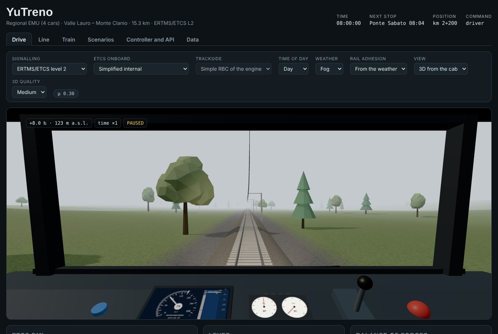

## Guidare

Ogni corsa parte ferma, con un briefing che dice linea, treno, orario e condizioni. Si chiude il briefing e si porta il manipolatore in trazione. Il manipolatore ha diciotto posizioni più l'urgenza: dieci gradini di trazione, il neutro e sette di frenatura di servizio.

| Tasto | Azione |
| :-- | :-- |
| ↑ oppure W | manipolatore verso la trazione |
| ↓ oppure S | manipolatore verso la frenatura |
| N | neutro |
| Spazio | conferma della vigilanza |
| E | frenatura d'urgenza |
| P | pausa |
| T | accelera il tempo (×1, ×2, ×4, ×8) |
| M | audio acceso o spento |

Con un controller standard la croce muove il manipolatore, A conferma la vigilanza, B comanda l'urgenza e Start mette in pausa. Una leva USB si calibra con il pulsante *Calibrate physical lever* della scheda *Drive*. Gli stessi comandi sono anche pulsanti nel pannello del manipolatore, sotto la vista, utili su telefono e tablet.

Lo scopo è arrivare al capolinea rispettando l'orario e fermandosi a ogni stazione con la testa del treno entro 20 m dalla palina, senza far intervenire la protezione. In stazione le porte restano aperte almeno 20 secondi e fino all'orario di partenza, di più se i passeggeri stanno ancora salendo, e la trazione è inibita finché non si chiudono. In marcia la vigilanza chiede una conferma ogni 55 secondi: se non arriva entro 5 secondi scatta l'urgenza.

## La cabina

La vista 3D mette il macchinista al banco di manovra. Al centro c'è il DMI, lo stesso disegnato nel pannello sotto la vista. Accanto ci sono i manometri della condotta generale (BP) e dei cilindri del freno (BC), il manipolatore che segue la posizione scelta, il pulsante blu della vigilanza, che lampeggia quando chiede conferma, e il fungo rosso dell'urgenza. Le spie sopra i manometri indicano vigilanza, porte, slittamento e urgenza. Con la pioggia si muove il tergicristallo; di notte e in galleria si accendono i fari e la luce di cabina.

Dal finestrino si vedono la linea come è stata disegnata, con curve, pendenze e gallerie con i loro portali, e le stazioni con banchine, pensiline, fabbricato e cartello con il nome. Ci sono poi la catenaria, i cippi chilometrici, i segnali luminosi del blocco automatico o le tabelle di arresto dell'ETCS e il treno che precede, con i fanali rossi di coda.

| | |
| :-: | :-: |
| 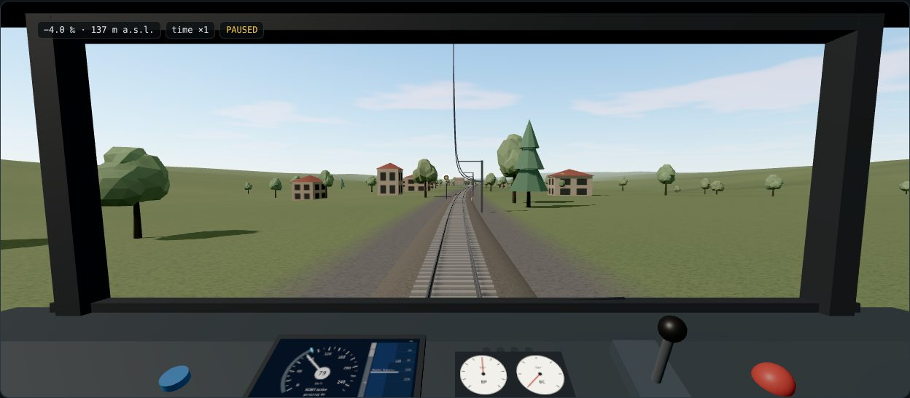 | 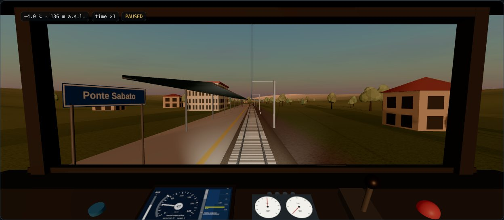 |
| 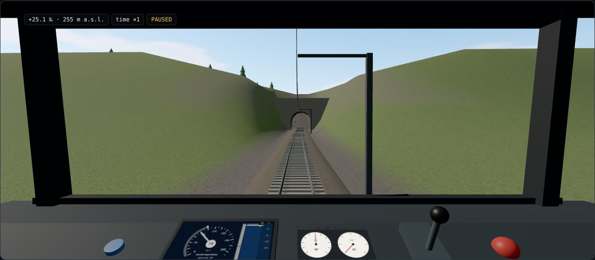 | 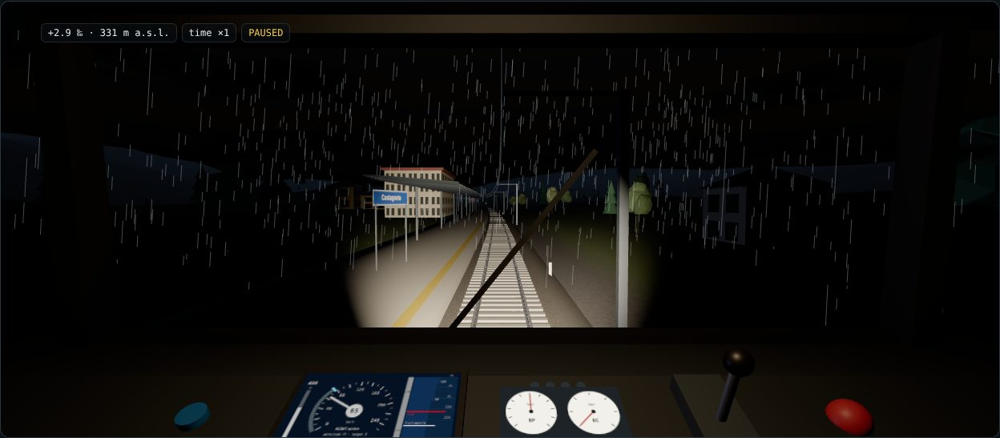 |

Nella barra sopra la vista si scelgono la vista e la qualità grafica. La vista *Essential 2D* è più leggera e resta disponibile anche quando il browser non supporta WebGL. La qualità *Low* toglie le ombre e sfoltisce alberi e traverse; sui telefoni è la scelta iniziale. Se il sistema chiede di ridurre il movimento, la camera non oscilla e il tergicristallo resta fermo.

*Ride in* porta la vista 3D nella cabina di un altro treno della corsa, su qualunque linea della rete: quando il treno è su un'altra linea il mondo si costruisce da quella linea, e l'etichetta la nomina. Si vede la linea da lì, anche nel senso opposto, e un'etichetta riporta numero, velocità e prossima fermata. Si continua a guidare il proprio treno con il manipolatore e il DMI qui sotto, e il proprio treno si vede sulla linea come gli altri. Con i passeggeri l'etichetta dei passeggeri segue il treno in cui si sta, e sulle banchine si vedono le persone in attesa, una figura per persona fino a 60 per banchina.

## Condizioni

Nella stessa barra si sceglie il segnalamento. Con **ERTMS/ETCS level 2** non ci sono segnali luminosi: il DMI mostra la velocità consentita, la distanza dall'obiettivo e le curve di supervisione. Prima vengono l'indicazione e l'avviso, poi la frenatura di servizio comandata dal bordo e, se non basta, l'urgenza. Con il **blocco automatico e SCMT** si guida a vista dei segnali, che hanno tre aspetti, e SCMT interviene solo se si supera la curva verso un segnale rosso.

Con ETCS la voce *ETCS onboard* sceglie chi fa la supervisione. *Simplified internal* è quella di sempre. *Reference, balises and messages* fa parlare il RBC con i messaggi della specifica e usa un calcolatore di bordo con le curve del Subset-026. *External via API* collega un calcolatore di bordo esterno, all'indirizzo che compare accanto. I dettagli sono in [BORDO_ETCS.md](BORDO_ETCS.md).

Con un bordo a messaggi si può scegliere anche il *Trackside*. *Simple RBC of the engine* è quello di sempre. *Interlocking and RBC* fa nascere l'autorizzazione dagli itinerari di un apparato, con deviatoi e circuiti di binario. Sotto lo schema della linea compare allora il **quadro del posto centrale**. Per ogni stazione mostra gli itinerari con il loro stato e un pulsante per comandarli o annullarli, i deviatoi con la posizione e il blocco, i circuiti di binario occupati o guasti. In alto ci sono la fine dell'autorizzazione inviata al treno, l'esclusione della formazione automatica degli itinerari e l'arresto d'emergenza. I dettagli sono in [TERRA.md](TERRA.md).

Ora del giorno e meteo cambiano luce, nebbia e pioggia. L'aderenza della rotaia, ricavata dal meteo oppure scelta a mano, cambia gli spazi di frenatura e la trazione possibile in salita. Su rotaia con foglie il treno slitta facilmente.

## Linee e treni

Nella scheda *Line* si disegna la planimetria trascinando i vertici, si scrive il profilo altimetrico e si compilano stazioni, orario, limiti di velocità e gallerie. Le linee si salvano nella libreria del browser e si esportano in JSON. *Apply and restart* fa partire una corsa sulla linea modificata.

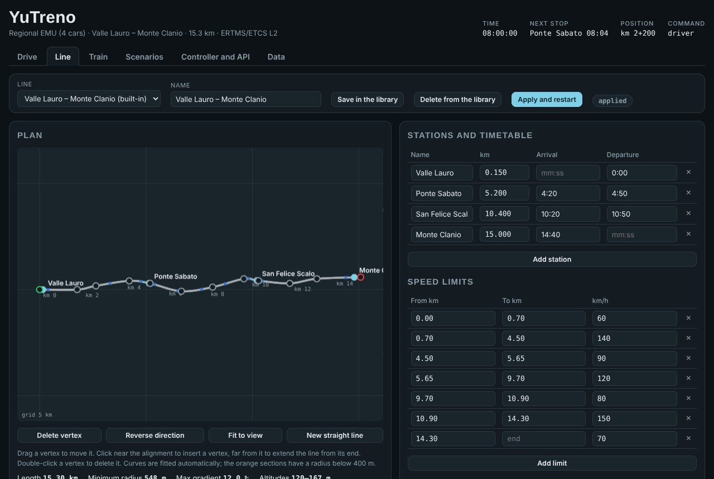

Nella scheda *Train* si scelgono un modello predefinito (regionale, alta velocità, merci) e i suoi parametri: masse, sforzo e potenza, resistenze al moto, frenatura. Si sceglie anche il modello di calcolo. Il *multi-mass* simula ogni veicolo e ogni accoppiatore; il *point mass* (punto materiale) è più semplice e adatto alla didattica. Le forze lungo il treno durante la corsa si vedono nel pannello *Forces along the train* della scheda *Drive*. La pagina `dist/model.html` spiega il modello con equazioni e un laboratorio interattivo.

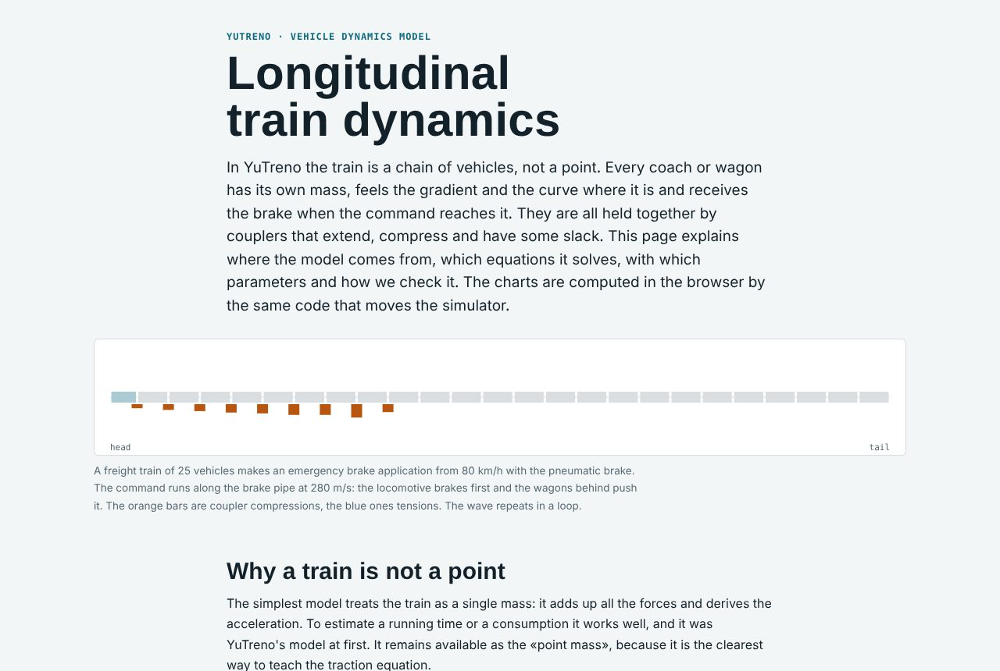

Il terzo modello di calcolo, *External via API*, fa calcolare la dinamica a un programma esterno, per esempio MATLAB/Simulink. La pagina lo interroga a ogni intervallo di accoppiamento, all'indirizzo indicato accanto alla scelta del modello. Come collegarlo è spiegato in [DINAMICA_ESTERNA.md](DINAMICA_ESTERNA.md).

## Scenari

Uno scenario prepara la corsa e programma eventi a tempo o a posizione: perdita della radio, rallentamenti, foglie, freno o trazione degradati, treno che precede fermo, un treno di servizio guasto, un tratto di linea interrotto, arresto d'emergenza, messaggi, comandi del dirigente e, con la terra con apparato, deviatoi e circuiti guasti e comandi del posto centrale. Alla fine i suoi criteri danno un verdetto, superato o fallito, con il dettaglio dei controlli. Alcuni eventi sono annunciati in cabina; altri, come un freno che si degrada, si scoprono solo dai loro effetti. Il formato e gli scenari di esempio sono descritti in [SCENARI.md](SCENARI.md); [GUIDA_SCENARI.md](GUIDA_SCENARI.md) accompagna nella scrittura di uno scenario da zero.

**Make a scenario.** In cima alla scheda un modulo crea uno scenario senza scrivere JSON: una linea (quella in uso, una predefinita o una delle linee reali di `examples/infra`), quanti treni di servizio, ogni quanti minuti e in quali versi, e quanti passeggeri all'ora partono da ogni stazione, come flusso continuo o a caso. Per Salerno – Mercato San Severino i treni possono essere quelli del suo orario reale, da un'ora scelta. Il modulo usa la stessa configurazione di scenario della riga di comando ([CONFIGURAZIONE_SCENARIO.md](CONFIGURAZIONE_SCENARIO.md)).

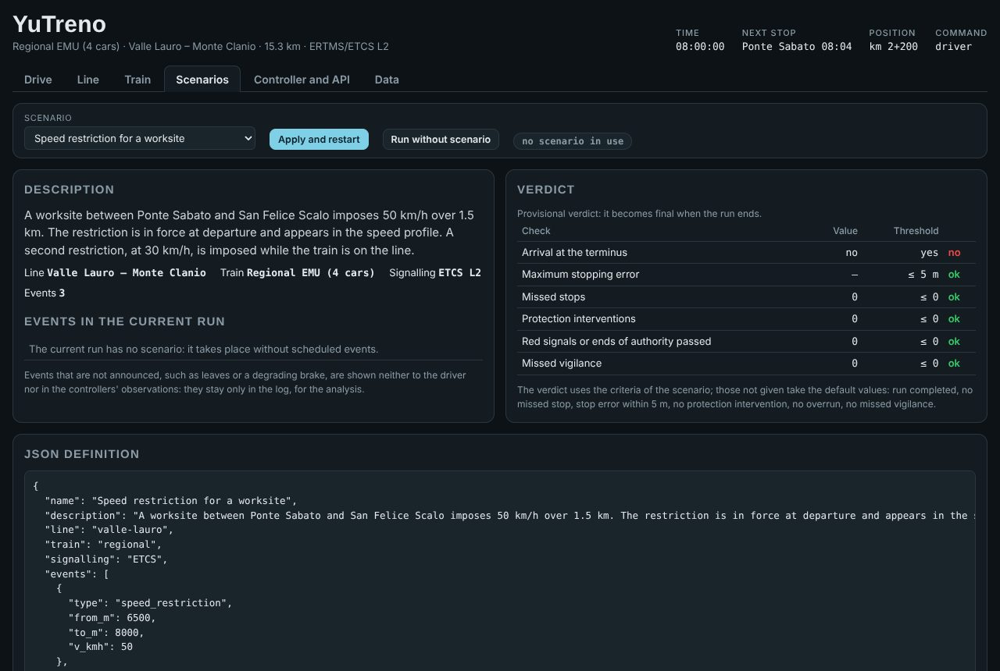

## Orario e altri treni

La scheda *Timetable* aggiunge alla corsa treni di servizio: altri treni con fermate e orari, guidati dall'ATO interno, nel verso della linea o in quello opposto. La linea fra le stazioni è a binario unico e ogni stazione ha due binari e due marciapiedi collegati da una passerella, quindi i treni si incrociano e si precedono in stazione; fra le stazioni ogni tratta è assegnata a un verso alla volta. Gli altri treni compaiono sullo schema di linea della scheda *Drive* (blu verso la fine della linea, ambra in senso opposto) e nella vista 3D, dove i treni in senso opposto fermano sul secondo binario.

Il grafico spazio-tempo ha il tempo verso destra e la linea verso il basso: tratteggiato l'orario programmato, continuo ciò che i treni hanno fatto nella corsa corrente, in verde il treno comandato. Un servizio si aggiunge con i due pulsanti, si modifica nella tabella delle fermate (orari hh:mm:ss, sosta minima) o si sposta nel tempo trascinandone la linea tratteggiata. I controlli segnalano soste più brevi del minimo e incroci o precedenze programmati fra due stazioni, dove il binario unico non li consente. *Apply timetable and restart* mette i servizi nello scenario in uso. Il formato è descritto in [SCENARI.md](SCENARI.md#treni-di-servizio).

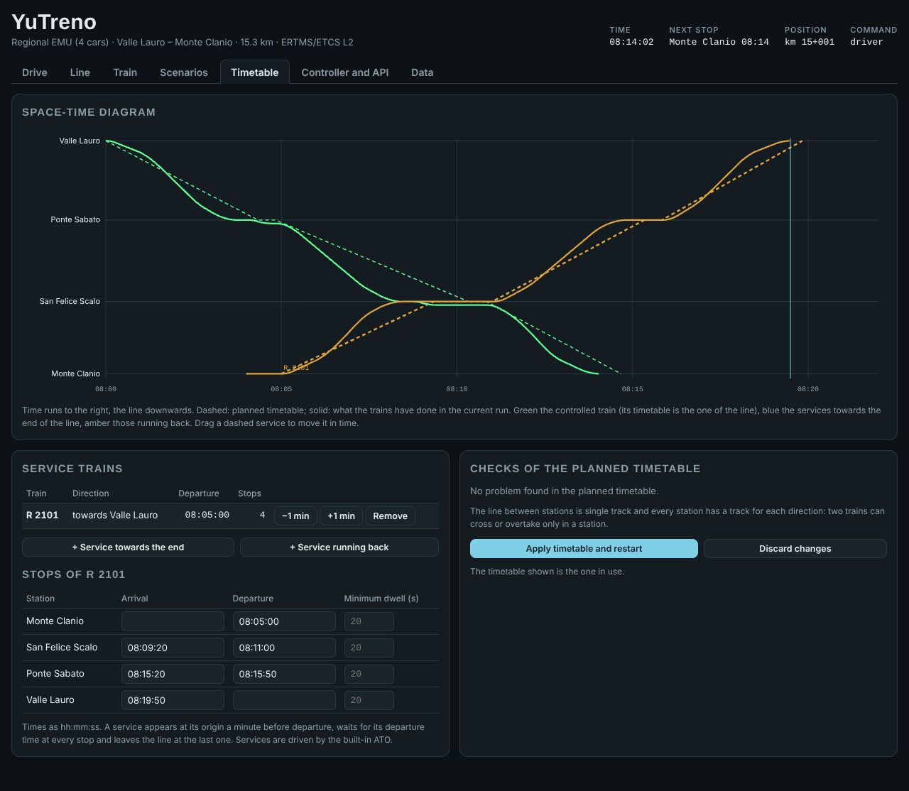

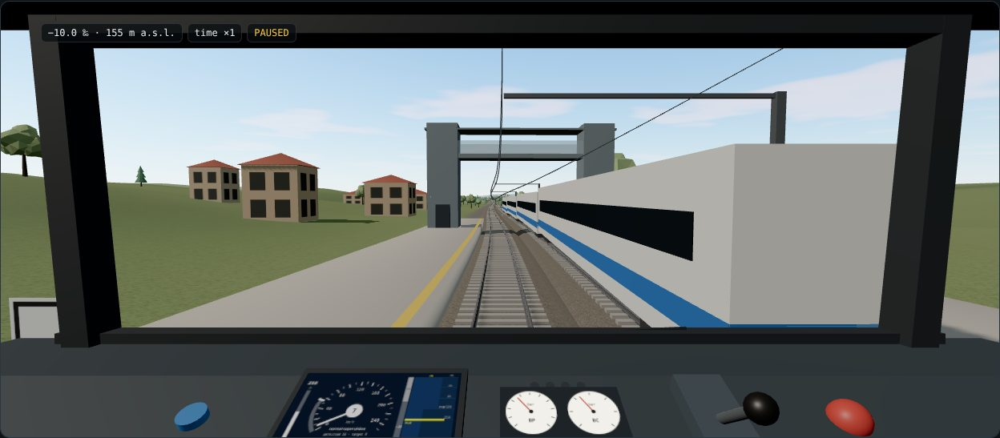

## Sala di controllo

La scheda *Control room* mostra la circolazione come la vede un posto centrale: uno schema di tutta la rete con segnali, sezioni occupate, il verso di ogni tratta a binario unico e i treni colorati secondo il ritardo; una tabella dei treni con stato, ritardo e prossima fermata; il registro della corsa. Con la terra con apparato mostra anche itinerari e deviatoi e ha i comandi del posto centrale. Ogni treno è sullo schema, anche quando corre su una linea diversa dalla principale. Con i passeggeri lo schema riporta le persone in attesa in ogni stazione e la tabella quelle a bordo di ogni treno. Un treno scelto con un clic nella sala di controllo è messo in evidenza nel grafico spazio-tempo. Il pannello *Dispatcher* trattiene il treno scelto per due minuti alla prossima fermata, gli fa saltare quella fermata o lo fa terminare lì, gli dà precedenza, e mette in vigore o revoca un rallentamento sulla linea principale; il motore applica il comando o dice perché non può, e *Write into the scenario* trasforma i comandi dati in eventi dello scenario, così la corsa si può ripetere. Dettagli in [SALA_CONTROLLO.md](SALA_CONTROLLO.md).

**Passeggeri in cabina.** Con i passeggeri un'etichetta in cima alla vista riporta, in fermata, quanti scendono e salgono e i secondi di salita che restano (le porte restano aperte fino ad allora), e in marcia quanti sono a bordo. Il riepilogo a fine corsa aggiunge i passeggeri trasportati, la loro attesa, il viaggio, il ritardo e l'energia per passeggero-km ([PASSEGGERI.md](PASSEGGERI.md)).

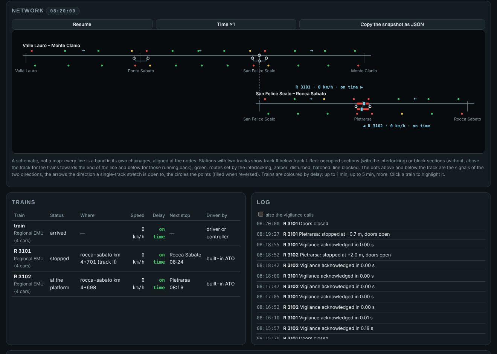

## Guida automatica

Nella scheda *Controller and API* si può scrivere un controllore in JavaScript, che gira in un Web Worker isolato, oppure collegare un programma esterno via WebSocket, in qualsiasi linguaggio. In entrambi i casi la simulazione si ferma a ogni periodo di controllo, invia ciò che vedrebbe il macchinista e riprende solo quando arriva il comando, quindi il risultato non dipende dalla velocità del computer. Muovere il manipolatore a mano riprende il comando. Il protocollo è in [API.md](API.md).

L'editor parte con l'ATO semplice di esempio. Il pulsante *Subset-130 example* carica invece un ATO che usa i dati del bordo per l'ATO, come la posizione del limite di intervento e la decelerazione sicura, e pianifica la frenatura senza inseguire la curva consentita. *Restore example* torna all'ATO semplice. Un controllore scritto per la versione 0.x, che definisce `controllo(oss, mem)`, funziona ancora e riceve l'osservazione con i nomi italiani.

## Dati della corsa

La scheda *Data* raccoglie gli indicatori della corsa, l'elenco delle fermate con il loro errore e il registro degli eventi. Da qui si copiano negli appunti gli eventi e il CSV, che ha una riga ogni mezzo secondo con posizione, velocità, forze, energia, stato della supervisione e accoppiatori. A fine corsa compare il resoconto con il verdetto. Le stesse corse si ripetono senza grafica con `npm run headless`, anche in serie su tutti gli scenari.
