# YuTreno

> Copia italiana. Il documento di riferimento è il [README in inglese](../../README.md); i nomi di file, comandi e formati sono quelli della versione inglese, e i nomi italiani della versione 0.x restano accettati.

*Il treno lo guidi tu, o il tuo algoritmo.*

YuTreno è un simulatore di guida ferroviaria che gira nel browser, pensato per la ricerca e la didattica. Si può guidare un treno a mano dalla cabina oppure affidarlo a un controllore automatico, scritto in JavaScript o in qualsiasi linguaggio che parli WebSocket (c'è un esempio in Python). La stessa linea si può percorrere con ERTMS/ETCS livello 2 o con il blocco automatico e la protezione SCMT, per confrontare i due sistemi. Linee e treni si disegnano e si modificano dall'interfaccia.

Attorno al treno guidato la linea può avere un traffico intero: treni di servizio con orario nei due sensi, reti di linee che si incontrano nelle stazioni in comune, linee reali importate da OpenStreetMap e RINF, passeggeri sulle banchine e a bordo, un regolatore della circolazione e una sala di controllo. Una corsa pubblica il suo orario e il suo andamento come dati aperti (GTFS, GTFS-Realtime, SIRI, NeTEx, railML).

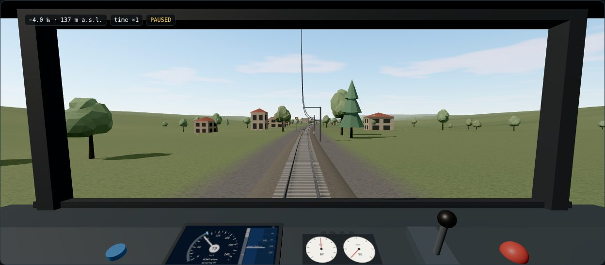

La vista è dalla cabina, in 3D. Dal finestrino si vedono la linea con le sue curve, pendenze e gallerie, le stazioni, la catenaria, i segnali e il treno che precede. Al banco ci sono il DMI, i manometri, il manipolatore e i pulsanti di vigilanza e urgenza. Luce e atmosfera cambiano con l'ora del giorno e il meteo. Una vista 2D più leggera resta disponibile, anche per i browser senza WebGL.

| | |
| :-: | :-: |
| 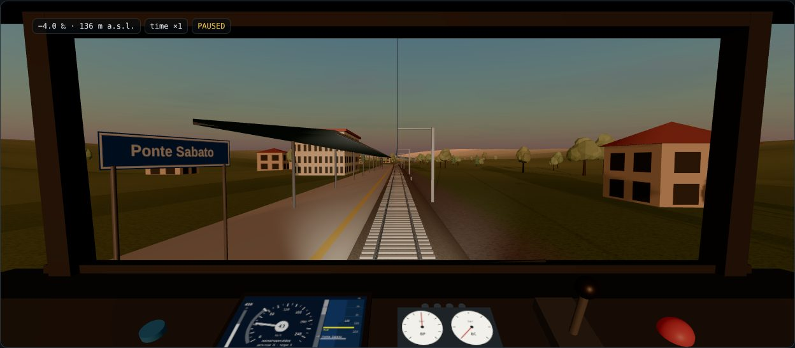 | 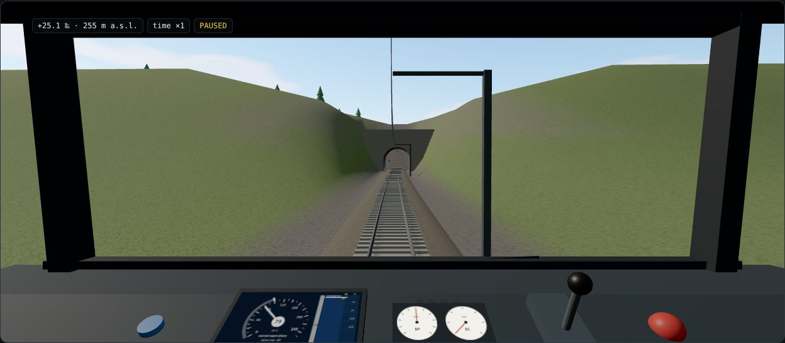 |
| 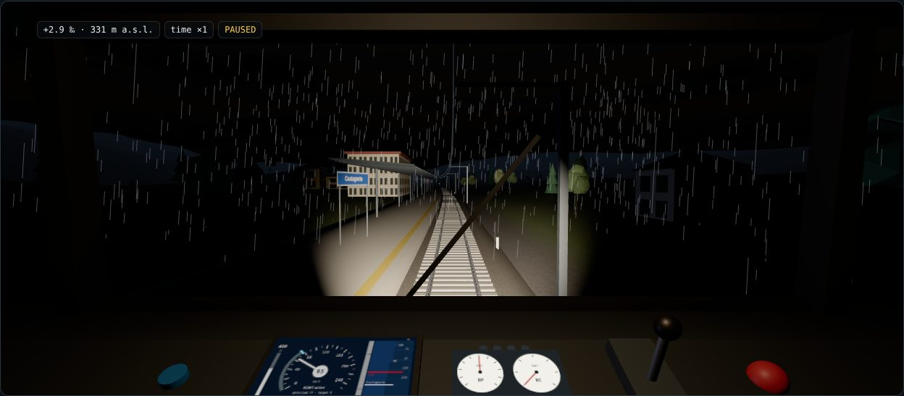 | 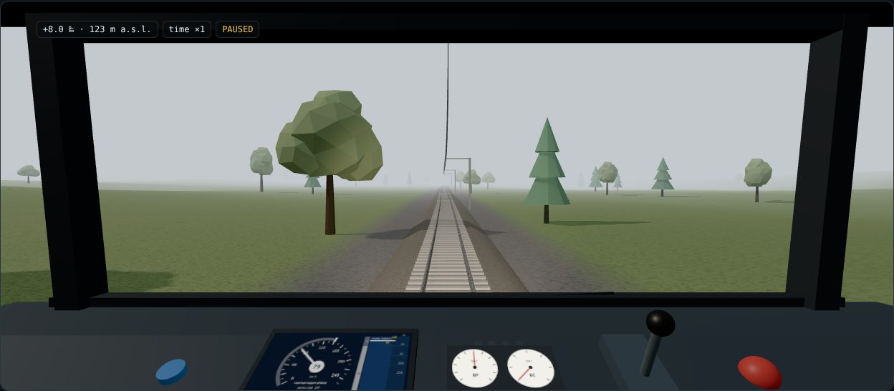 |

Il treno è simulato come una catena di veicoli collegati da accoppiatori con gioco, rigidezza e smorzamento (modello multi-massa), oppure come un punto materiale per la didattica. La pagina `dist/model.html`, generata dalla build, descrive il modello con equazioni, verifiche e un laboratorio interattivo. La simulazione avanza a passo fisso di 5 ms ed è deterministica: a parità di linea, treno, scenario e comandi, due corse producono gli stessi dati. Senza grafica una corsa completa richiede uno o due secondi.

## Avvio rapido

```bash
npm install
npm run dev          # interfaccia su http://localhost:8000
npm run build        # dist/yutreno.html, un file unico apribile con doppio clic
npm run verify       # tutte le verifiche: fisica, segnalamento, bordo, terra, circolazione, rete, passeggeri, dati aperti, requisiti
npm run headless -- --line appennino --signalling BACC --output runs
npm run headless -- --scenario scenarios                  # tutti gli scenari di eventi e guasti, con verdetto
npm run headless -- --onboard reference                   # ETCS con boe, messaggi del RBC e bordo di riferimento
npm run headless -- --onboard reference --trackside interlocking   # in più apparato e RBC con itinerari, deviatoi e circuiti
npm run headless -- --dynamics tcp://localhost:5555       # dinamica del treno da un modello esterno (MATLAB/Simulink)
npm run headless -- --dynamics "exec:octave-cli -q examples/octave/yutreno_dynamics.m"   # oppure Octave, avviato dal motore
```

La guida passo passo [GUIDA_SCENARI.md](GUIDA_SCENARI.md) va da una cartella vuota a uno scenario proprio eseguito senza grafica e nella pagina.

Oppure, con Docker, un ambiente di prova completo che esegue una demo e resta acceso con simulatore, ponti e programmi esterni ([DOCKER.md](DOCKER.md)):

```bash
docker build -f docker/Dockerfile -t yutreno-demo .
docker run --rm -p 8000:8000 -p 8766:8766 -p 8767:8767 yutreno-demo     # poi http://localhost:8000/results/
```

Con un controllore esterno in Python:

```bash
pip install websockets
python examples/example_controller.py                     # in ascolto su ws://localhost:8765
npm run headless -- --controller ws://localhost:8765      # corsa senza grafica
```

Lo stesso script funziona con l'interfaccia aperta in locale: scheda *Controller and API*, pulsante *External controller*.

## Dinamica esterna

La dinamica del treno si può sostituire con un modello esterno, per esempio in MATLAB/Simulink, collegato al motore in co-simulazione. A ogni intervallo di accoppiamento il motore manda comandi, linea attorno al treno e guasti, e riceve posizione, velocità e forze. Segnalamento, supervisione, scenari e verdetto restano quelli di YuTreno, quindi lo stesso controllore e gli stessi scenari mettono alla prova modelli diversi. Il collegamento passa via TCP, WebSocket o un processo avviato dal motore che parla su stdin/stdout, sia nelle corse senza grafica sia nella pagina. Ci sono esempi pronti in Python (`examples/python/`), in Octave (`examples/octave/`) e in MATLAB (`examples/matlab/`), con il punto materiale come modello da sostituire e la traccia per un modello Simulink. Tutto è descritto in [DINAMICA_ESTERNA.md](DINAMICA_ESTERNA.md).

## Bordo ETCS a messaggi

Con ERTMS/ETCS livello 2 la supervisione di bordo può passare da quella semplificata a un calcolatore di bordo che conosce il mondo solo attraverso boe e messaggi del Subset-026. Il RBC manda autorizzazione al movimento, profilo statico di velocità, pendenze e rallentamenti riferiti all'ultimo gruppo di boe letto. Il bordo si localizza, calcola le curve di frenatura e comanda frenatura di servizio e d'urgenza. YuTreno ha un bordo di riferimento con le curve del §3.13, e lo stesso protocollo permette di collegare un EVC esterno (processo, TCP o WebSocket) e metterlo alla prova sugli stessi scenari. In `examples/onboard/` c'è un bordo minimo in Python da usare come traccia. Tutto è descritto in [BORDO_ETCS.md](BORDO_ETCS.md).

## Lato terra: apparato e RBC

Il RBC semplice del motore calcola l'autorizzazione dal treno che precede. Con `--trackside interlocking` (o il menu *Trackside* della pagina) l'autorizzazione nasce invece come in un impianto vero. Un apparato comanda deviatoi e legge circuiti di binario con i telegrammi EULYNX (SCI-P, SCI-TDS). Forma gli itinerari descritti da una Tabella delle Condizioni in stile RFI, con un traduttore, e il RBC costruisce l'autorizzazione dagli itinerari formati. La formazione automatica degli itinerari instrada il treno secondo l'orario e lo manda sul binario di precedenza quando il binario di corretto tracciato è occupato. Deviatoi e circuiti si possono guastare negli scenari, e il posto centrale può comandare itinerari, escludere la formazione automatica e fermare il treno. Il motore simula solo il piazzale e parla con il lato terra attraverso un protocollo pubblico: lo stesso lato terra gira dentro il processo o come programma esterno. Tutto, con l'elenco delle semplificazioni, è in [TERRA.md](TERRA.md).

## ATO e campagna di misura

L'API del controllore, dalla versione 2, passa all'ATO anche i dati che il bordo ETCS gli mette a disposizione secondo il Subset-130: MRSP, fine dell'autorizzazione, posizione del limite d'intervento più vicino, decelerazione sicura, pendenze e tempi di reazione. `examples/ato_s130.js` è un ATO che li usa per pianificare la frenatura invece di inseguire la curva consentita. `npm run campaign` mette a confronto i due ATO con la supervisione semplificata e con il bordo di riferimento, su tutti gli scenari ETCS con e senza guasti nascosti. Produce un CSV con misure, parametri e impronte SHA-256 di ogni corsa, più verifiche di determinismo anche con il bordo esterno. Il metodo e i risultati sono in [CAMPAGNA.md](CAMPAGNA.md). `examples/driver_model.js` è un modello di macchinista umano, con tre profili e un seme, e `npm run driver-campaign` lo confronta con l'ATO ([MODELLO_MACCHINISTA.md](MODELLO_MACCHINISTA.md)).

## Standard e requisiti

[STANDARD.md](STANDARD.md) discute gli standard a cui YuTreno attinge (Subset-026, Subset-130, EULYNX, pratica RFI, SCMT): cosa prescrive ciascuno, cosa YuTreno ne prende e dove si ferma. La matrice dei requisiti ([TRACCIABILITA.md](TRACCIABILITA.md)) elenca 383 righe del Subset-026, del Subset-130, di EULYNX e della pratica RFI con il loro stato (implementata, semplificata, divergente, mancante, fuori ambito); ogni riga implementata o semplificata è collegata ai test che la controllano, e `npm run verify` fallisce se una ne è priva.

## Documentazione

- [Che cosa si può fare con YuTreno](FUNZIONI.md): ogni funzione per categoria, i limiti, la struttura, una mappa della documentazione e i riferimenti, in un solo posto.
- [Guida d'uso](GUIDA.md): cabina, comandi, condizioni, editor, scenari e guida automatica, con le immagini delle schede.
- [Guida agli scenari](GUIDA_SCENARI.md): da zero all'esecuzione di uno scenario proprio, passo per passo.
- [API del controllore](API.md): osservazioni, comandi e protocollo WebSocket.
- [Scenari](SCENARI.md): formato, tipi di evento, criteri e verdetto.
- [Modello fisico e di segnalamento](MODELLO.md), con la pagina interattiva `dist/model.html`.
- [Uso dell'IA](USO_IA.md): come è stato sviluppato YuTreno, chi ha fatto che cosa e come si controlla il lavoro.
- [Stato dell'arte e come riprendere](STATO_DELL_ARTE.md): la versione breve, con la roadmap da qui.
- [Stato, decisioni e piano](ROADMAP.md): a che punto è il progetto e che cosa viene dopo, per chi lo riprende.
- [Standard](STANDARD.md): Subset-026, Subset-130, EULYNX, Tabelle delle Condizioni RFI e SCMT, e quanto YuTreno li segue.
- [Documenti di progetto](progetto/LEGGIMI.md): un documento per componente (nucleo, dinamica, segnalamento, bordo di riferimento, RBC semplice, terra con apparato, protocolli, interfaccia web, strumenti).
- [Dinamica esterna](DINAMICA_ESTERNA.md): co-simulazione con MATLAB/Simulink o altri programmi.
- [Bordo ETCS](BORDO_ETCS.md): boe, RBC a messaggi, bordo di riferimento e collegamento di un EVC esterno.
- [Lato terra](TERRA.md): apparato e RBC, telegrammi EULYNX, Tabella delle Condizioni, protocollo fra motore e terra e semplificazioni.
- [Guida per collegare un EVC](GUIDA_EVC.md): dal bordo minimo al proprio calcolatore di bordo, con la strada per integrare openETCS.
- [Modello di macchinista umano](MODELLO_MACCHINISTA.md): un macchinista con uno stile e una risposta in ritardo, tre profili con un seme, e la campagna che li confronta con l'ATO.
- [Campagna di misura](CAMPAGNA.md): matrice bordo × ATO × scenario con impronte delle corse e verifiche di determinismo, per separare l'effetto del bordo da quello dell'ATO.
- [Validazione delle curve](VALIDAZIONE_CURVE.md): confronto del bordo di riferimento con lo strumento delle curve di frenatura dell'ERA.
- [Bordi indipendenti](BORDI_INDIPENDENTI.md): fattibilità e stima dell'impegno per collegare cesarBLG/ETCS e milanredele/etcs-dmi.
- [Tracciabilità](TRACCIABILITA.md): matrice dei requisiti e collegamenti fra requisiti e test.
- [Tempo reale](TEMPO_REALE.md): misure di quanto motore e canali esterni riescono a seguire l'orologio, e che cosa servirebbe a un banco con hardware vero.
- [Agenti](AGENTI.md): guidare i treni di servizio da fuori, con un ambiente per l'apprendimento per rinforzo e un esempio Python/Gymnasium.
- [Regolatore della circolazione](REGOLATORE.md): il programma che decide priorità, nuovi orari, fermate saltate, binari e cambi di percorso, con il suo protocollo e il regolatore di riferimento.
- [Capacità della linea](CAPACITA.md): il distanziamento minimo calcolato dai tempi di occupazione (UIC 406 semplificata) contro quello misurato.
- [Sala di controllo](SALA_CONTROLLO.md): tutta la rete con i treni, i segnali, le sezioni occupate e gli itinerari, da un'unica istantanea pubblica del motore (`controlRoom()`), servita anche su `/control-room`.
- [Dati aperti](DATI_APERTI.md): l'orario e l'andamento di una corsa come GTFS, GTFS-Realtime, SIRI, NeTEx (profilo italiano) e railML, serviti in HTTP; importazione di orari da GTFS, NeTEx e railML.
- [Passeggeri](PASSEGGERI.md): domanda origine–destinazione, salite e discese, soste, capacità, massa a bordo e misure, con l'occupazione in SIRI e GTFS-Realtime.
- [Configurazione di scenario](CONFIGURAZIONE_SCENARIO.md): un JSON breve che sceglie la linea e il numero di treni, generati o presi da un orario reale.
- [Tutorial: una linea reale partendo da zero](TUTORIAL_LINEA.md): dalle fonti pubbliche a una linea che YuTreno percorre, a mano o con `npm run line-from-sources`.
- [Importazione dell'infrastruttura reale](IMPORTAZIONE_INFRA.md): una linea da OpenStreetMap e RINF, con la provenienza di ogni dato, le licenze e un rapporto dell'importazione.
- [Standard degli orari](STANDARD_ORARI.md): Transmodel, NeTEx, SIRI, GTFS e railML, il quadro normativo e i profili italiani, con esempi commentati da [examples/feeds/](../../examples/feeds/).
- [Modellino fisico](MODELLINO.md): studio di fattibilità e prima bozza di un plastico guidato da YuTreno, con boe NFC e un RBC via radio.
- [Architettura del codice](ARCHITETTURA.md): per chi modifica YuTreno.
- [Demo in Docker](DOCKER.md): un ambiente di prova completo in un container.

| | |
| :-: | :-: |
| 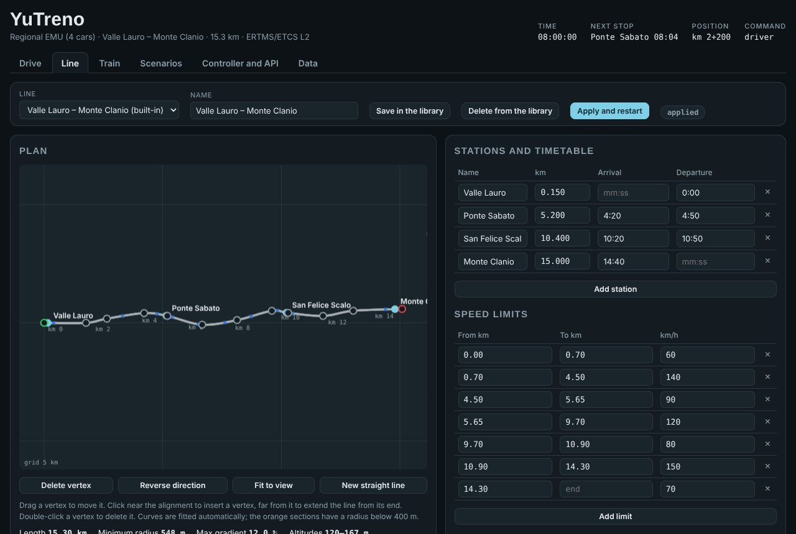 | 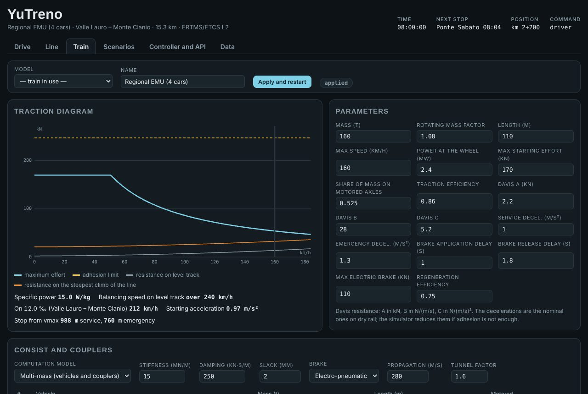 |
| 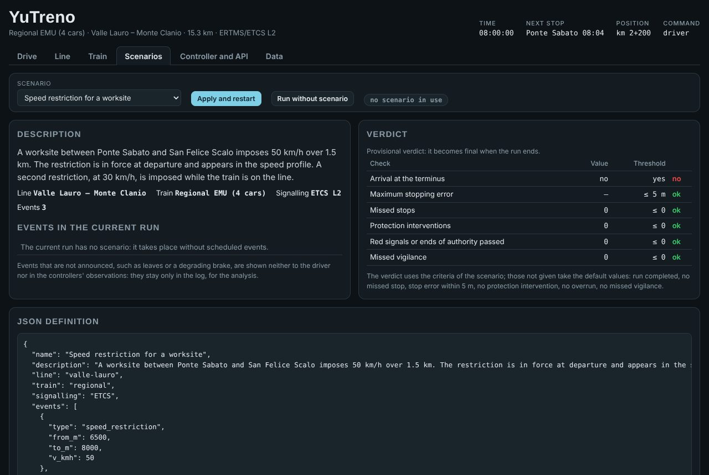 | 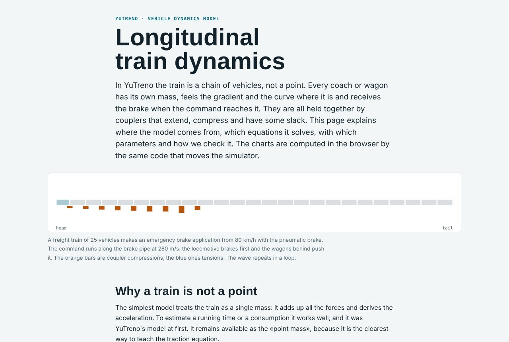 |
| 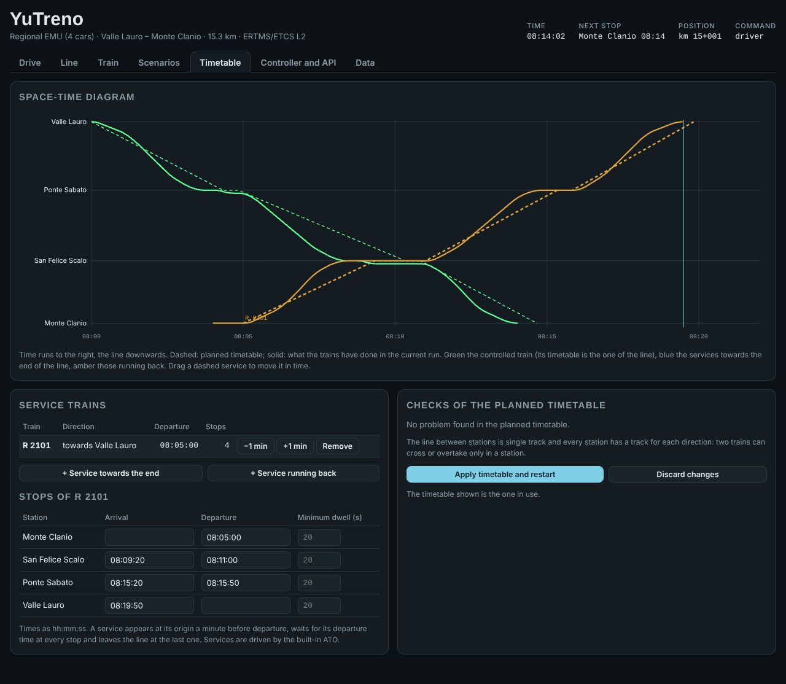 | 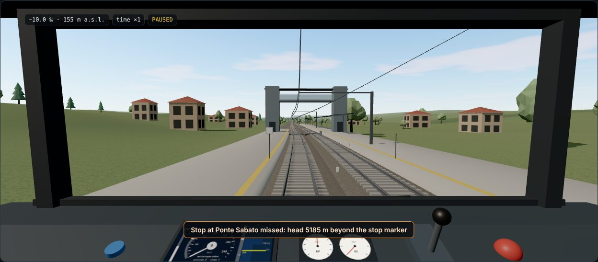 |

## Struttura

| Cartella | Contenuto |
| :-- | :-- |
| `src/core/` | Nucleo della simulazione, senza dipendenze dal browser né da Node: linea, rete, treni, segnalamento e supervisione, dinamica, bordo di riferimento, piazzale della terra con apparato, circolazione di più treni, passeggeri, API di osservazione e comando, esecuzione al passo, istantanea della sala di controllo, compatibilità con i nomi italiani della versione 0.x (`legacy.ts`) |
| `src/trackside/` | Lato terra: apparato, RBC, Tabella delle Condizioni con il traduttore e protocollo verso il motore; non dipende dal motore |
| `src/regulator/` | Il regolatore della circolazione di riferimento e il suo protocollo; non dipende dal motore |
| `src/feeds/` | Dati aperti di una corsa (GTFS, GTFS-Realtime, SIRI, NeTEx, railML) e importazione degli orari |
| `src/infra/` | Importazione di una linea reale da OpenStreetMap, RINF e un modello del terreno |
| `src/web/` | Interfaccia: vista 3D dalla cabina (`view3d.ts`, Three.js) e vista 2D, DMI, manipolatore, editor, orario, sala di controllo, controllori nel browser, audio, dispositivi di ingresso |
| `src/server/` | Strumenti Node: esecuzione senza grafica, ponte verso i programmi esterni, ambiente per gli agenti, server dei dati aperti, importatori, generatore di scenari |
| `examples/` | Controllori di esempio (`ato.js`, `ato_s130.js` con i dati del Subset-130, `example_controller.py`), bordi ETCS esterni (`onboard/`), lato terra e regolatore come programmi esterni (`trackside/`, `regulator/`), modelli di dinamica esterni (`dynamics_point.js`, `python/`, `octave/`, `matlab/`), un ambiente per gli agenti (`agents/`), configurazioni di scenario, linee importate (`infra/`) e dati aperti prodotti (`feeds/`) |
| `scenarios/` | Scenari di eventi e guasti con i criteri del verdetto, usati dalla pagina e dalle corse senza grafica; `scenarios/trackside/` quelli della terra con apparato, `scenarios/services/` quelli con treni di servizio |
| `scripts/` | Build, verifiche `verify-*.ts`, golden master delle corse e della pagina, tracciabilità dei requisiti, campagne di misura, validazione delle curve |
| `golden/` | Impronte dei golden master |
| `campaigns/` | Configurazioni delle campagne di misura |
| `validation/` | Casi per il confronto con lo strumento delle curve di frenatura dell'ERA |
| `src/docs/` | Pagina che descrive il modello dinamico, con grafici e laboratorio calcolati dal nucleo |
| `docs/` | Guide, API, scenari, modello, standard, documenti di progetto, tracciabilità; `docs/img/` contiene le immagini, `docs/it/` le copie italiane |

## Verifiche

`npm run verify` esegue tutti gli script `scripts/verify-*.ts`, due alla volta (`-- --quick` solo quelli brevi):

- `verify-line`: lunghezze delle linee predefinite, profilo, limiti contigui e segnali coerenti con le stazioni.
- `verify-physics`: spazio di frenatura, velocità di equilibrio, partenza in salita, limite di aderenza, con entrambi i modelli dinamici.
- `verify-dynamics`: modello multi-massa confrontato con il trenino a due masse di Gîlcă e Borcoși, equilibrio statico, propagazione del freno, convergenza con il passo, Röckl e Curtius-Kniffler.
- `verify-external-dynamics`: il punto materiale riscritto come modello esterno riproduce quello interno; determinismo, richieste e trasporto TCP.
- `verify-onboard`: boe, messaggi del RBC, bordo di riferimento su linee e scenari, guidatore che non frena mai, bordo esterno.
- `verify-subset026`: test a livello di requisito del bordo di riferimento contro il Subset-026 e il Subset-130, un blocco per gruppo di clausole, in forma chiusa dove la clausola dà una formula.
- `verify-ato-s130`: le versioni dell'API; `N_LOC_EBI` coincide con il punto in cui la protezione interviene davvero; dati per l'ATO uguali con il bordo interno ed esterno; l'ATO Subset-130 guida senza interventi e consuma quasi lo stesso con entrambi i bordi.
- `verify-trackside`: traduzione delle Tabelle delle Condizioni, apparato contro il piazzale (formazione, itinerari in conflitto, distruzione ritardata, guasti, liberazione elastica, deviatoio tallonato), corse nominali e scenari con la terra con apparato, terra esterna identica a quella nel processo, superamento sul binario II.
- `verify-curve-validation`: lo strumento di validazione delle curve riproduce le formule in forma chiusa in piano e mette le curve nell'ordine atteso.
- `verify-scenarios`: validazione, fusione dei limiti, verdetto, effetto di ogni tipo di evento, esiti attesi degli scenari di esempio e determinismo.
- `verify-services`: treni di servizio con orario: validazione, partenze in orario, distanza fra i treni, propagazione di un ritardo con ETCS e con il blocco automatico, la linea ribaltata, incroci sul binario unico (mai due treni opposti in una tratta, un treno in ritardo fa ritardare quello opposto), agenti uguali all'ATO interno, determinismo.
- `verify-regulator`: il protocollo del regolatore, le sue decisioni e i loro effetti, il regolatore di riferimento su un guasto e su una linea interrotta, il regolatore esterno identico a quello nel processo.
- `verify-capacity`: il distanziamento minimo fra due treni uguali entro il 5 % di quello calcolato dai tempi di occupazione, e il determinismo di tutta la catena.
- `verify-network`: reti e corridoi, itinerari di nodo, corse sulle reti con ogni lato terra, regolatore e cambi di percorso.
- `verify-passengers`: conservazione dei passeggeri, sosta, capacità, massa a bordo, determinismo, occupazione nei dati aperti.
- `verify-control-room`: l'istantanea della sala di controllo contro lo stato del motore, su una linea e su una rete.
- `verify-feeds` e `verify-imports`: i dati aperti (struttura, riferimenti, accordo fra i formati) e l'andata e ritorno degli orari attraverso GTFS, NeTEx e railML.
- `verify-infra`: l'importazione di una linea reale da fonti sintetiche e dalle linee reali di `examples/infra/`.
- `verify-scenario-config`: scenari da una configurazione breve, e la campagna del servizio.
- `verify-ato`: il controllore di esempio percorre tutte le combinazioni di linea e segnalamento senza interventi della protezione. Le fermate devono stare entro 3 m dal picchetto e due corse uguali devono dare dati identici. I risultati devono coincidere con i valori di riferimento.
- `verify-traceability`: ogni requisito implementato o semplificato della matrice ha almeno un test, e i file di tracciabilità sono aggiornati.

`npm run golden` esegue ogni scenario in sei varianti di segnalamento, bordo, terra e regolatore, e le due campagne, e fallisce se una parte di una corsa è cambiata; `scripts/page-golden.mjs` fa lo stesso per la pagina.

Se una modifica cambia di proposito la fisica, i valori di riferimento in `scripts/verify-ato.ts` si aggiornano nello stesso commit, spiegando il motivo nel messaggio.

## Scenari

Uno scenario prepara una corsa e programma eventi nel tempo o nello spazio:

- perdita del collegamento radio con il RBC;
- rallentamenti;
- zone di aderenza ridotta;
- freno o trazione degradati;
- treno che precede fermo, un treno di servizio guasto, un tratto di linea interrotto;
- arresto d'emergenza;
- messaggi al macchinista;
- comandi del dirigente;
- con la terra con apparato, deviatoi e circuiti di binario guasti e comandi del posto centrale.

Uno scenario può avere anche treni di servizio con il loro orario, una rete, passeggeri e coincidenze fra treni.

Alla fine della corsa i criteri dello scenario danno un verdetto, superato o fallito, con l'elenco dei controlli. Gli eventi che a bordo non si vedono, come le foglie o un freno degradato, non vengono mostrati né mandati ai controllori. Il formato è descritto in [SCENARI.md](SCENARI.md).

## Compatibilità con la versione 0.x

Fino alla versione 0.1 tutti i formati di YuTreno usavano nomi italiani. Sono ancora accettati: scenari, linee, treni, opzioni della riga di comando (`--linea`, `--bordo`, `--terra`…), controllori che definiscono `controllo(oss, mem)`, programmi esterni che parlano il protocollo versione 1. La traduzione avviene in ingresso in `src/core/legacy.ts`, e i programmi esterni della 0.x ricevono il formato italiano con `--protocol 1`. Vedi [API.md](API.md#versioni).

## Prossimi passi

A che punto è il progetto e la roadmap da qui stanno in [STATO_DELL_ARTE.md](STATO_DELL_ARTE.md); ogni passo e ogni decisione in [ROADMAP.md](ROADMAP.md). Fra le cose che restano: il passaggio fra RBC a un nodo e più RBC su una rete, un apparato per stazione con la protezione di fianco, il blocco mobile con la terra con apparato, la validazione delle curve del bordo con lo strumento dell'ERA, passeggeri che scelgono il percorso, istantanee e riproduzione per l'istruttore, iconografia del DMI conforme alle specifiche ERA, sessioni con più utenti, e un plastico guidato da YuTreno ([MODELLINO.md](MODELLINO.md)).

## Licenza

Copyright 2026 Nicola Amatucci. Il codice è distribuito con la [Licenza Pubblica dell'Unione europea v. 1.2](../../LICENSE) (EUPL-1.2), la documentazione con CC BY 4.0; i dati di OpenStreetMap, RINF ed EU-DEM in `examples/infra/` mantengono le licenze delle loro fonti. I dettagli stanno in [NOTICE.md](../../NOTICE.md). YuTreno è stato sviluppato con un assistente di programmazione basato sull'IA sotto la direzione del suo autore: vedi [USO_IA.md](USO_IA.md).

Se ritieni che qualcosa in questo repository violi un tuo diritto d'autore o non citi correttamente una fonte, [apri una segnalazione](../../../../issues/new?template=copyright.md), anche in italiano: riceverà risposta e, se la segnalazione è fondata, il materiale sarà rimosso o citato come si deve ([NOTICE.md](../../NOTICE.md#reporting-a-copyright-concern)).
