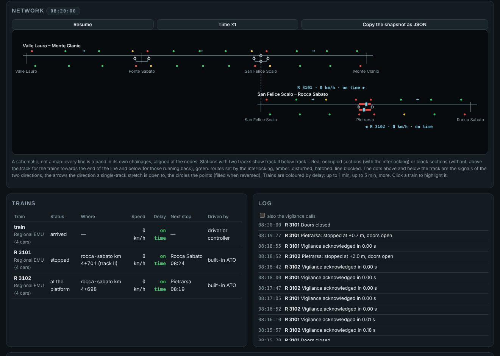

# Sala di controllo

La scheda *Control room* della pagina mostra la circolazione come la vede un operatore di un posto centrale. Contiene uno schema di tutta la rete, una tabella dei treni, il registro della corsa e i comandi che esistono già. La sua sola fonte è un'istantanea prodotta dal motore, `Simulation.controlRoom()`. La stessa istantanea è servita dal server dei dati aperti su `/control-room`, così un programma esterno, per esempio un regolatore o un cruscotto, vede esattamente ciò che mostra la pagina.

Originale inglese: [../CONTROL_ROOM.md](../CONTROL_ROOM.md).



## Che cosa mostra

**Lo schema.** È uno schema topologico, non una carta, come i quadri luminosi e gli schermi di un posto centrale. Ogni linea è una banda orizzontale disegnata nelle sue progressive. Le bande si dispongono a partire dalla linea principale seguendo i nodi, e ognuna è spostata in modo che il suo nodo cada alla stessa ascissa che ha sulla linea a cui si unisce. Un raccordo tratteggiato unisce i due punti di ogni nodo; dove si chiude un anello, come con il raccordo Ponte Sabato – Pietrarsa, il raccordo è obliquo. Niente è disegnato a mano, quindi lo stesso codice disegna anche le reti importate, come Cancello – Benevento con Avellino – Benevento.

Su ogni banda lo schema mostra:
- le stazioni, con il binario II sotto il binario I in quelle che ne hanno due;
- i segnali dei due versi, sopra il binario per i treni verso la fine della linea e sotto per quelli che tornano, colorati secondo l'aspetto (in ETCS livello 2 sono i marker, colorati come la sezione dietro di loro);
- l'occupazione: senza apparato, le sezioni di blocco che ogni verso vede occupate, sopra e sotto il binario; con l'apparato, i circuiti di binario che la terra segnala occupati (rosso) o guasti (ambra), sul binario a cui appartengono;
- con l'apparato, gli itinerari formati o in uso (verde) e i deviatoi, pieni quando sono in rovescio;
- il verso verso cui è aperta ogni tratta a binario unico: l'orientamento del motore, oppure il consenso di blocco dell'apparato;
- le tratte interrotte da un disservizio, tratteggiate;
- con i passeggeri ([PASSEGGERI.md](PASSEGGERI.md)), le persone in attesa in ogni stazione;
- con la terra del motore su una rete, gli itinerari di nodo e il treno che li tiene.

**I treni.** Ogni treno è disegnato su ogni linea che occupa, dalla coda alla testa, sul binario II quando è lì. L'etichetta alla testa riporta numero, velocità e ritardo. Treno ed etichetta sono colorati secondo il ritardo: fino a un minuto, fino a cinque, oltre. Un clic su un treno lo evidenzia sullo schema e nella tabella.

**La tabella dei treni.** Ogni riga dà lo stato del treno (non ancora sulla linea, in marcia, fermo, in sosta al marciapiede, guasto, soppresso, arrivato), dove si trova, la velocità, il ritardo, la prossima fermata con l'orario previsto (e quello nuovo quando il regolatore l'ha cambiato) e chi lo guida. Quando ci sono, compaiono anche il servizio dello stesso giro che il treno diventa e le coincidenze che aspetta. Con i passeggeri una colonna riporta le persone a bordo, i posti a sedere e in piedi e quanto è pieno il treno. Un clic su un treno nella tabella o nello schema lo mette in evidenza anche nel grafico orario della scheda *Timetable*.

**Il registro.** Elenca gli eventi di tutti i treni nell'ordine in cui sono avvenuti: disservizi, decisioni del regolatore, coincidenze, interventi della protezione, fermate. Le chiamate della vigilanza sono nascoste, a meno di chiederle.

**I comandi.** La pagina manda solo comandi che esistono già. Ci sono la pausa e la velocità del tempo. Con la terra con apparato ci sono anche i comandi del posto centrale: formazione automatica degli itinerari attiva o no, arresto d'emergenza di tutti i treni, formazione di un itinerario libero e annullamento di uno in uso. Decide l'apparato; la pagina si limita a mandare.

## Il dirigente

Sotto il registro, il pannello *Dispatcher* dà a mano le decisioni di un regolatore della circolazione. Si sceglie un treno con un clic, poi lo si trattiene due minuti alla prossima fermata (`retime`), gli si fa saltare la prossima fermata (`skip_stop`), lo si fa terminare lì (`cancel`) o gli si dà precedenza nei conflitti (`priority`). Un rallentamento sulla linea principale si mette in vigore o si revoca da una progressiva a un'altra, e ogni treno lo vede attraverso il proprio segnalamento (l'autorizzazione ETCS o la restrizione del blocco automatico). La pagina invia soltanto il comando: il motore lo applica o dice perché non può (un treno già passato, una fermata che è l'origine, il treno comandato, che mantiene le fermate della sua linea), e lo scrive nel registro.

I comandi arrivano al motore con `Simulation.dispatch(c)`, che può chiamare anche un programma: `c` è un comando del protocollo del regolatore ([REGOLATORE.md](REGOLATORE.md)) oppure `{ type: 'speed_restriction', from_m, to_m, v_kmh, revoke? }`, e la risposta è null o il motivo del rifiuto. Ogni comando applicato è registrato con il suo istante in `Simulation.dispatched`, che il pannello mostra e copia come JSON: dando gli stessi comandi agli stessi istanti la corsa si ripete identica. *Write into the scenario* li mette, come eventi `dispatch` (`withDispatched(def, sim.dispatched)`), nel JSON della scheda Scenari: applicato lì, lo scenario li ridà ai loro istanti e la corsa è quella in cui sono stati dati dal vivo (`CR3`). I comandi venuti dallo scenario sostituiscono i suoi eventi `dispatch`, quindi riscrivendo dopo una corsa ripetuta non si raddoppiano.

## L'istantanea

`Simulation.controlRoom(logLimit = 200)` restituisce una `ControlRoomSnapshot` (`src/core/control-room.ts`). È un'interfaccia pubblica come i protocolli: i nomi sono inglesi, la versione sta in `version` (ora 1), e cresce solo con campi facoltativi. Le progressive sono quelle di ogni linea, in metri dalla sua origine, e il verso +1 va verso la fine della linea. L'esempio completo del formato è nel documento inglese.

```json
{ "type": "control_room", "version": 1, "t_s": 1000, "signalling": "ETCS", "trackside": "interlocking",
  "network": { "name": "...", "nodes": [ { "name": "San Felice Scalo", "lines": ["valle-lauro", "rocca-sabato"] } ],
    "lines": [ { "id": "valle-lauro", "name": "...", "length_m": 15300,
      "stations": [ { "name": "Ponte Sabato", "s_m": 5200, "tracks": 2 } ], "directions": [1, -1],
      "signals": [ { "id": "4", "s_m": 4950, "dir": 1, "kind": "H", "aspect": "Y" } ],
      "blocks": [ { "from_m": 400, "to_m": 1866.7, "dir": 1, "occupied": true } ],
      "single_track": [ { "from_m": 400, "to_m": 4950, "orientation": 1 } ], "blocked": [],
      "sections": [ { "id": "Ponte Sabato/1PZ", "from_m": 4900, "to_m": 4940, "track": "*", "state": "vacant", "locked": false } ],
      "points": [ { "id": "Ponte Sabato/1", "s_m": 4900, "track": "II:Ponte Sabato", "position": "N", "locked": false, "fault": false } ],
      "routes": [ { "id": "Ponte Sabato/1", "name": "Entry to Ponte Sabato on track I", "from_m": 4950, "to_m": 5450, "dir": 1, "state": "set", "track_from": "I", "track_to": "I" } ] } ] },
  "trains": [ { "id": "R 3101", "train": "Regional EMU (4 cars)", "driver": "ato", "status": "running", "route": ["valle-lauro", "rocca-sabato"],
    "line": "rocca-sabato", "dir": 1, "s_m": 2310.4, "occupies": [ { "line": "rocca-sabato", "from_m": 2210.4, "to_m": 2310.4 } ],
    "v_kmh": 98.2, "delay_s": 21.3, "next_stop": { "station": "Pietrarsa", "planned_arrival_s": 1170, "arrival_s": 1170 }, "track": null } ],
  "log": [ { "t_s": 999.2, "train": "R 3101", "kind": "INFO", "text": "..." } ],
  "panel": { "ars": true, "routes": [], "points": [], "tvps": [], "ma": null, "speed_restrictions": [] } }
```

- `network.lines[]`: le stazioni con il numero dei binari; i versi in cui qualche treno percorre la linea; i segnali e le sezioni di blocco di ognuno di quei versi, con gli aspetti e l'occupazione che vedono i segnali; le tratte a binario unico con il loro orientamento (+1, −1, 0 libera, null dove niente le orienta); le tratte interrotte da un disservizio. Con la terra del motore su una rete, `node_routes`. Con la terra con apparato, `sections`, `points` e `routes` (gli itinerari non liberi, tranne quelli del blocco automatico).
- `trains[]`: uno per ogni treno della corsa, anche quelli non ancora sulla linea o già arrivati (con `line` null). `line`, `dir` e `s_m` collocano la testa, `occupies` il tratto di ogni linea su cui il treno si trova. `delay_s` è il ritardo all'ultima fermata servita, rispetto all'orario programmato, come nel protocollo del regolatore. `track` (con l'apparato) vale `II` mentre il treno è su un binario di precedenza.
- con i passeggeri ([PASSEGGERI.md](PASSEGGERI.md)), due campi facoltativi: `waiting` su ogni stazione di una linea, le persone sulle sue banchine, e `passengers` su ogni treno, `{ onboard, seats, standing, occupancy }` con il livello di occupazione di SIRI. Leggerli non cambia la corsa, anche con arrivi di Poisson: le persone arrivate da quando un treno è passato l'ultima volta si contano al loro numero atteso fino al passaggio successivo.
- `log`: gli ultimi `logLimit` eventi di tutti i treni, dal più vecchio.
- `panel`: con la terra con apparato, il quadro del posto centrale come l'ha restituito la terra.

L'istantanea è una funzione dello stato della corsa: legge e non cambia niente, quindi due corse uguali danno istantanee uguali.

Il server dei dati aperti la serve su `GET /control-room` (`?log=<n>` per il numero di eventi), e `npm run feeds -- --at <s> --out <cartella>` la scrive come `control-room.json` accanto ai flussi.

## Verifiche

`scripts/verify-control-room.ts` prende un'istantanea ogni 10 s di tempo simulato su quattro corse: l'incrocio su una linea con il blocco automatico e con l'apparato, e la diramazione con il blocco automatico e con l'apparato. Controlla:
- ogni linea della rete, e i segnali con gli aspetti e le posizioni delle linee orientate;
- con l'apparato, lo stato di ogni sezione come lo vede il campo, tranne quelle cambiate nell'ultimo ciclo della terra (il quadro è indietro di un ciclo);
- ogni treno nella tabella; ogni treno attivo sullo schema, sulla linea della sua testa con progressiva e velocità, anche fuori dalla linea principale; la sezione di blocco sotto la testa occupata;
- i ritardi rispetto all'orario della corsa, e il registro in ordine;
- il determinismo: due corse uguali danno le stesse istantanee.

`scripts/control-room-shots.mjs` (Playwright, non fra le dipendenze) apre la pagina con ogni scenario incluso, fa avanzare la corsa, apre la sala di controllo e salva una schermata. Fallisce se la pagina segnala un errore o se un treno attivo manca dallo schema. Con `--interlocking` esegue ogni scenario con il bordo di riferimento e la terra con apparato.

**Verifiche della pagina della fase 7.** `scripts/page-checks.mjs` (Playwright, come sopra) crea uno scenario con passeggeri dal modulo della scheda *Scenarios*, controlla l'etichetta dei passeggeri in una fermata, le persone in attesa e a bordo nella sala di controllo, l'evidenza di un treno nel grafico orario, la vista dalla cabina di un treno per ciascun verso e uno scenario con l'orario reale di Salerno – Mercato San Severino, e salva le immagini.

`verify-control-room` (`CR2`) mette un rallentamento (il treno che segue resta sotto il limite), trattiene un treno, fa saltare una fermata, controlla tre rifiuti con i loro motivi e ripete la corsa dalla registrazione dei comandi.

## Limiti

- Lo schema disegna le stazioni come vengono generate oggi: binario I e binario II fra i deviatoi, senza la geometria dei deviatoi. I circuiti di binario e i deviatoi vengono dalla terra, quindi una stazione con altri binari sarà disegnata dai suoi dati.
- Il pannello *Dispatcher* dà solo alcune delle decisioni che un regolatore può prendere: trattenere, saltare una fermata, terminare alla prossima fermata, precedenza e rallentamenti. Un binario, un cambio di percorso o una coincidenza si danno da un programma con `Simulation.dispatch()`.
